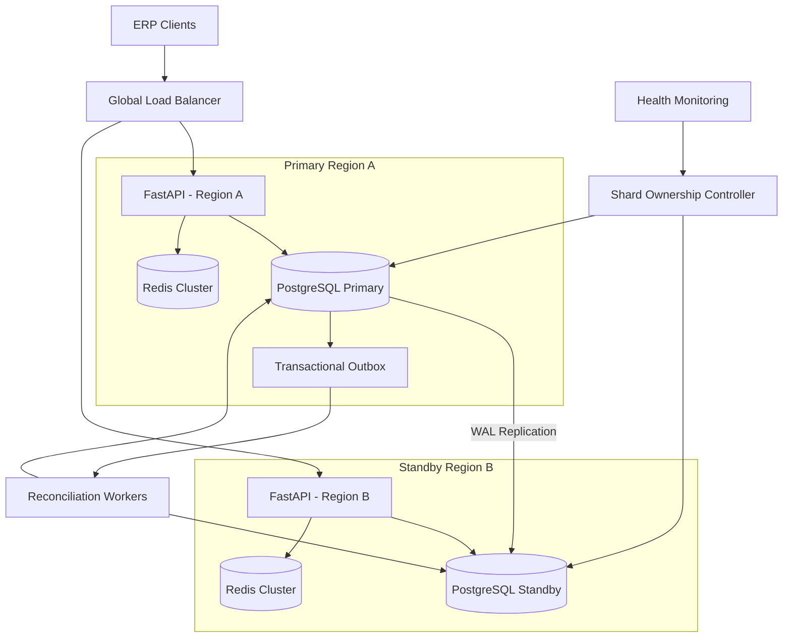
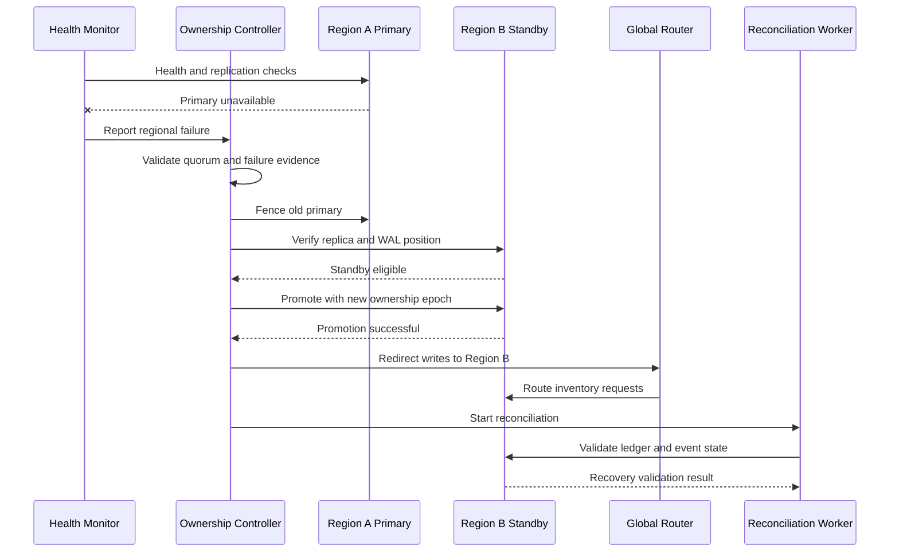

# Architecture Decision Record: Disaster Recovery and Failover Strategy for Cross-Region ERP Distributed Inventory

| Field | Value |
|---|---|
| Document Type | Architecture Decision Record (ADR) |
| System | Enterprise Resource Planning – Distributed Inventory |
| Status | Proposed – Ready for Review |
| Decision Area | Disaster Recovery, Regional Failover, Data Reconciliation |
| Related Architecture | Warehouse Sharding, Redis Cluster Caching, Hybrid Consistency, Saga Transactions |
| Primary Technologies | Python, FastAPI, PostgreSQL, Redis |
| Difficulty | Advanced |

---

## 1. Executive Summary

This ADR defines the disaster recovery (DR), regional failover, and data reconciliation strategy for the cross-region ERP distributed inventory system.

The system maintains inventory across geographically distributed warehouse shards. Each warehouse has an authoritative PostgreSQL owner responsible for inventory ledger writes, stock reservations, and deductions.

A regional outage or network partition can interrupt communication between regions. If multiple regions independently accept writes for the same inventory shard, the system risks split-brain operation, duplicate reservations, overselling, and inconsistent inventory balances.

The recommended strategy is:

**Active-passive ownership for critical inventory ledger writes, with active-active application availability and read access.**

Each inventory shard has exactly one authorized write owner at a time. A standby region can take ownership only after a controlled failover process verifies that the previous owner is fenced from accepting writes.

The strategy combines:

- PostgreSQL streaming replication and recoverable write-ahead logs (WAL).
- Single-writer ownership enforced through leases, ownership epochs, and fencing tokens.
- Automated health checks and controlled regional promotion.
- Transactional outbox and idempotent Saga event processing.
- Automated ledger reconciliation and anti-entropy procedures.
- Redis cache invalidation and rebuilding after recovery.

The design prioritizes inventory correctness over uninterrupted write availability during uncertain network partitions.

---

## 2. Context and Existing Architecture

The current ERP architecture contains the following components:

| Component | Responsibility |
|---|---|
| FastAPI services | Inventory, reservation, order, and orchestration APIs |
| PostgreSQL | Authoritative inventory ledger and reservation storage |
| Redis Cluster | Distributed read cache |
| Warehouse shards | Geographically partitioned inventory ownership |
| Transactional outbox | Reliable publication of committed inventory events |
| Saga orchestrator | Coordinates cross-region inventory commitments |
| CQRS projections | Provides eventually consistent global inventory visibility |
| Reconciliation workers | Detects and repairs recoverable data drift |

### 2.1 Existing consistency model

The system follows hybrid consistency.

1. Strong consistency is enforced within the authoritative PostgreSQL warehouse shard for stock reservations and deductions.
2. Eventual consistency is used for cross-region inventory projections, dashboards, and reporting.
3. Redis provides fast reads but never authorizes inventory commitments.
4. Saga coordinates multi-warehouse reservations through local transactions and compensating operations.

### 2.2 Disaster recovery problem

Consider a warehouse whose primary inventory database is hosted in Region A and whose standby replica is hosted in Region B.

If communication between the regions fails:

- Region A may continue operating.
- Region B may incorrectly assume Region A is unavailable.
- Both regions could attempt to accept inventory writes.
- A previously committed reservation may not yet have reached the standby replica.
- Cross-region Saga events may be delayed or delivered more than once.

A failover strategy must prevent the standby from becoming a second independent writer.

---

## 3. Disaster Recovery Objectives

The following targets are proposed service objectives. They must be validated through load testing, replication measurements, and regional failure exercises before being treated as production guarantees.

### 3.1 Recovery Point Objective (RPO)

RPO defines the maximum acceptable amount of committed data loss following a failure.

| Data Category | Target RPO | Mitigation |
|---|---:|---|
| Authoritative inventory ledger | 0 for acknowledged commits under synchronous replication | Synchronous replication for critical commits |
| Reservation records | 0 for acknowledged commits under synchronous replication | Durable PostgreSQL commit and replicated WAL |
| Transactional outbox | 0 for acknowledged commits under synchronous replication | Same database transaction as business update |
| Saga orchestration state | 0 for acknowledged state transitions under synchronous replication | Durable state storage and idempotent recovery |
| Global inventory projections | ≤ 5 minutes | Event replay and projection rebuilding |
| Analytics and reporting data | ≤ 15 minutes | Periodic snapshots and event replay |
| Redis cache | No persistence guarantee | Rebuild from PostgreSQL and projections |

**Important:** An RPO of zero for acknowledged critical writes requires a synchronous durability arrangement that confirms the required replica has safely persisted the commit before success is returned. If synchronous replication is unavailable during a partition, the system must reject or pause affected critical writes rather than silently downgrade to unsafe asynchronous writes.

For geographically distant regions, synchronous replication can introduce substantial latency. The architecture therefore needs a clearly defined write-availability policy rather than assuming zero RPO and unrestricted write availability can both be guaranteed during every partition.

### 3.2 Recovery Time Objective (RTO)

RTO defines the maximum target time required to restore service after a failure.

| Failure Scenario | Target RTO | Recovery Action |
|---|---:|---|
| Application instance failure | ≤ 1 minute | Restart and load balancing |
| Database process failure | ≤ 3 minutes | Local database recovery or replica promotion |
| Availability-zone failure | ≤ 5 minutes | Promote a healthy replica in another zone |
| Regional database failure | ≤ 15 minutes | Fence old primary and promote standby |
| Cross-region network partition | ≤ 15 minutes for safe recovery after ownership is established | Quarantine uncertain writes and verify ownership |
| Projection or cache inconsistency | ≤ 10 minutes after primary service restoration | Replay events and rebuild projections/cache |

These are proposed engineering targets, not guaranteed timings. Actual RTO depends on database size, replication lag, failure detection, fencing, DNS or service-routing updates, and recovery validation.

### 3.3 Priority order

During a disaster, recovery follows this order:

1. Prevent split-brain and duplicate inventory commitments.
2. Establish a single authoritative write owner.
3. Recover the durable inventory ledger.
4. Restore reservation and Saga processing.
5. Reconcile cross-region events and projections.
6. Rebuild Redis caches and restore normal read performance.

---

## 4. Active-Active vs Active-Passive Trade-off Analysis

Two regional deployment models were evaluated for critical inventory ledger writes.

### 4.1 Active-Active

Both regions independently accept writes and synchronize inventory changes.

Advantages:
- Higher regional write availability.
- Lower user latency for geographically distributed customers.
- Better utilization of regional infrastructure.

Disadvantages:
- Concurrent writes can conflict.
- Network partitions can produce split-brain.
- Inventory reservations can be duplicated.
- Conflict resolution is difficult for non-commutative stock deductions.
- Requires more complex distributed coordination.

Active-active is suitable for read workloads and independently owned inventory shards, but unrestricted multi-writer access to the same shard is unsafe.

### 4.2 Active-Passive

One region owns critical inventory writes. A standby region receives replicated data and takes over only after the primary has been fenced.

Advantages:
- One authoritative writer per shard.
- Easier inventory ledger correctness.
- Predictable reservation and deduction semantics.
- Simpler recovery and reconciliation.
- Compatible with PostgreSQL single-primary replication.

Disadvantages:
- Failover introduces temporary write unavailability.
- Standby infrastructure may be underutilized.
- Synchronous replication can increase commit latency.
- Promotion requires ownership verification.

### 4.3 Decision matrix

Scoring: 1 = Poor, 3 = Moderate, 5 = Excellent.

| Evaluation Criteria | Active-Active | Active-Passive |
|---|---:|---:|
| Write availability during regional failure | 5 | 3 |
| Inventory consistency | 2 | 5 |
| Split-brain prevention | 2 | 5 |
| Implementation simplicity | 2 | 4 |
| Failover predictability | 3 | 4 |
| Cross-region write latency | 4 | 3 |
| Conflict-resolution complexity | 1 | 5 |
| PostgreSQL integration | 3 | 5 |
| Operational cost | 2 | 4 |
| Critical ledger correctness | 2 | 5 |
| **Total** | **26/50** | **43/50** |

### 4.4 Final decision

**Selected: Active-Passive for critical inventory ledger writes.**

The system will use active-active application deployments and read access where safe, but each warehouse inventory shard will have one authoritative write owner.

Different warehouses can have different primary regions. This preserves regional autonomy without allowing two regions to independently modify the same warehouse ledger.

---

## 5. Recommended Disaster Recovery Architecture

### 5.1 Architecture overview



The standby database remains read-only while Region A owns the shard. It cannot independently accept inventory mutations.

The shard ownership controller coordinates promotion, but the controller itself must not be the only protection against split-brain. Database write access must also be fenced through infrastructure-enforced controls.

### 5.2 Core architectural components

| Component | Responsibility |
|---|---|
| Primary PostgreSQL | Accepts authoritative inventory writes |
| Standby PostgreSQL | Receives replicated WAL and supports recovery |
| Ownership controller | Tracks the authorized shard owner and epoch |
| Health monitor | Detects database, network, and regional failures |
| Fencing mechanism | Prevents the former primary from accepting writes |
| Saga orchestrator | Recovers interrupted cross-region commitments |
| Reconciliation worker | Detects and repairs recoverable data drift |
| Redis | Rebuilt read cache after failover |
| Audit log | Records ownership changes and recovery decisions |

---

## 6. Split-Brain Prevention

Split-brain occurs when two regions believe they are the authorized primary for the same inventory shard.

This is the highest-risk failure because both regions could commit reservations against independently evolving inventory balances.

### 6.1 Ownership epochs

Each warehouse shard maintains a monotonically increasing ownership epoch.

Example:

| Event | Region | Epoch | Write Permission |
|---|---|---:|---|
| Normal operation | Region A | 41 | Allowed |
| Failover initiated | Region A | 41 | Revoked |
| Standby promoted | Region B | 42 | Allowed |
| Old region recovers | Region A | 41 | Denied |

Every write request carries the current ownership epoch.

Example:

```json
{
  "warehouse_id": "WH-101",
  "operation": "reserve_stock",
  "ownership_epoch": 42,
  "idempotency_key": "order-9001-reservation-1"
}
```

The inventory service rejects writes with stale ownership epochs.

### 6.2 Fencing requirements

Before Region B becomes writable:

1. The old primary must be confirmed stopped, isolated, or prevented from writing.
2. Its database credentials or write access must be revoked where appropriate.
3. The ownership controller must acquire a new valid ownership epoch.
4. The standby must be verified as the most recent eligible replica.
5. The standby is promoted.
6. The API write path is redirected to the new owner.
7. A controlled health check verifies successful writes.

A lease timeout alone is not sufficient proof that the former primary cannot still write.

Use infrastructure-enforced fencing, such as cloud instance isolation, storage or database write fencing, network policy, and credential revocation. The exact mechanism depends on the deployment environment.

### 6.3 Fail-closed policy

If the system cannot establish which region owns a shard:

- Reject new inventory reservations.
- Reject stock deductions.
- Do not accept writes against stale replicas.
- Continue serving clearly labeled last-known read projections where appropriate.
- Queue retryable business requests at the application boundary only when their idempotency and expiry semantics are defined.

Inventory correctness takes priority over accepting uncertain writes.

---

## 7. Automated Failover Workflow

### 7.1 Failure detection

Health checks monitor:

- PostgreSQL primary availability.
- Replication connection health.
- WAL replay lag.
- Regional network connectivity.
- Ownership lease validity.
- API health and request failure rates.
- Outbox processing delay.

A single missed health check must not trigger regional promotion. Multiple independent signals and a controlled failure-detection window reduce false failovers.

### 7.2 Failover sequence



### 7.3 Failover decision rules

| Condition | Action |
|---|---|
| Primary healthy, replication healthy | Continue normal operation |
| Primary unavailable, standby healthy, old primary fenced | Promote standby |
| Primary unavailable, standby lag exceeds accepted limit | Evaluate recovery point and require controlled recovery |
| Both regions unavailable | Keep writes disabled and recover from durable backups/WAL |
| Ownership cannot be verified | Do not promote automatically |
| Network partition without proof of primary failure | Preserve existing ownership and reject uncertain cross-region writes |

A network partition must not automatically be interpreted as a primary database failure.

---

## 8. Data Drift Mitigation During Network Partitions

Data drift occurs when replicas or projections no longer represent the same committed inventory history.

### 8.1 Common causes

- Delayed WAL replication.
- Outbox events not yet delivered.
- Duplicate event delivery.
- Out-of-order event processing.
- Interrupted Saga workflows.
- Stale Redis cache entries.
- A standby promoted from an incomplete replication point.

### 8.2 Prevention mechanisms

**A. Write-ahead logging**

Use PostgreSQL WAL-based replication to transfer committed database changes to the standby.

**B. Transactional outbox**

Inventory changes and their corresponding outbox events are committed in the same PostgreSQL transaction.

This prevents the database from recording a reservation without recording the event needed for downstream synchronization.

**C. Idempotent event consumers**

Each event has a globally unique event ID. Consumers maintain a processed-event record and ignore duplicate deliveries.

**D. Version-aware inventory updates**

Each warehouse inventory record has a monotonically increasing version.

A projection accepts an update only when its version is newer than the version already applied.

**E. Redis invalidation**

After failover, invalidate affected inventory cache keys and rebuild them from the authoritative database.

Redis must never be used to reconstruct the authoritative inventory ledger.

### 8.3 Inventory ledger invariants

Reconciliation must verify:

1. Available stock is not negative.
2. Reserved stock does not exceed physical stock.
3. Every confirmed reservation has a corresponding ledger transaction.
4. Every committed stock deduction has a valid order or adjustment reference.
5. Event IDs are unique.
6. Inventory versions are monotonic within each warehouse shard.
7. Released or expired reservations are not counted as active commitments.

Example inventory balance:

```text
available_stock = physical_stock - reserved_stock
```

The balance must be derived consistently from the authoritative ledger and reservation state.

---

## 9. Automated Reconciliation and Anti-Entropy

After failover, the system runs automated reconciliation to identify differences between the promoted primary, its recovered former primary, and downstream projections.

Reconciliation must not blindly overwrite newer authoritative ledger records with older replica data.

### 9.1 Reconciliation phases

**Phase 1: Establish authority**

- Confirm the promoted database's ownership epoch.
- Verify the former primary is fenced.
- Record the selected recovery point.
- Capture the latest known WAL position and replication status.

**Phase 2: Compare inventory state**

Compare warehouse inventory records using:

- Warehouse ID.
- Product ID.
- Inventory version.
- Physical quantity.
- Reserved quantity.
- Ledger transaction sequence.

**Phase 3: Reconcile events**

- Identify missing outbox events.
- Detect duplicate event IDs.
- Replay unprocessed events.
- Reject events from stale ownership epochs where they cannot be validated.
- Preserve event ordering for each inventory aggregate.

**Phase 4: Recover Saga workflows**

- Identify orders with incomplete reservations.
- Query each warehouse's authoritative reservation state.
- Confirm valid completed reservations.
- Release expired or invalid holds through compensating operations.
- Resume retryable workflows using the original idempotency keys.

**Phase 5: Rebuild projections and cache**

- Rebuild affected CQRS projections.
- Invalidate Redis entries.
- Repopulate frequently accessed inventory records.
- Verify projection versions against the authoritative database.

**Phase 6: Produce recovery report**

Record:

- Recovery epoch.
- Last confirmed WAL position.
- Number of records checked.
- Number of mismatches.
- Events replayed.
- Duplicate events ignored.
- Reservations recovered or compensated.
- Final reconciliation status.

### 9.2 Example PostgreSQL reconciliation query

The following query detects basic inventory balance violations.

```sql
SELECT
    warehouse_id,
    product_id,
    physical_stock,
    reserved_stock,
    (physical_stock - reserved_stock) AS available_stock
FROM inventory
WHERE physical_stock < 0
   OR reserved_stock < 0
   OR reserved_stock > physical_stock;
```

This query is a validation check, not a complete reconciliation algorithm. The actual ledger-to-balance comparison must also account for the system's reservation and adjustment transaction model.

### 9.3 Python reconciliation prototype

The following example illustrates a safe, report-first reconciliation process. It does not automatically modify inventory quantities.

```python
from dataclasses import dataclass
from typing import Iterable


@dataclass(frozen=True)
class InventoryRecord:
    warehouse_id: str
    product_id: str
    physical_stock: int
    reserved_stock: int
    version: int


@dataclass
class ReconciliationReport:
    checked: int
    mismatches: list
    invalid_records: list


def reconcile_inventory(
    primary_records: Iterable[InventoryRecord],
    recovered_records: Iterable[InventoryRecord],
) -> ReconciliationReport:
    primary = {
        (r.warehouse_id, r.product_id): r
        for r in primary_records
    }

    recovered = {
        (r.warehouse_id, r.product_id): r
        for r in recovered_records
    }

    mismatches = []
    invalid_records = []

    for key, authoritative in primary.items():
        recovered_record = recovered.get(key)

        if authoritative.physical_stock < 0:
            invalid_records.append({
                "key": key,
                "reason": "Negative physical stock",
            })

        if authoritative.reserved_stock < 0:
            invalid_records.append({
                "key": key,
                "reason": "Negative reserved stock",
            })

        if authoritative.reserved_stock > authoritative.physical_stock:
            invalid_records.append({
                "key": key,
                "reason": "Reserved stock exceeds physical stock",
            })

        if recovered_record is None:
            mismatches.append({
                "key": key,
                "reason": "Missing from recovered database",
                "authoritative_version": authoritative.version,
            })
            continue

        if authoritative.version != recovered_record.version:
            mismatches.append({
                "key": key,
                "reason": "Version mismatch",
                "authoritative_version": authoritative.version,
                "recovered_version": recovered_record.version,
            })

        if (
            authoritative.physical_stock
            != recovered_record.physical_stock
            or authoritative.reserved_stock
            != recovered_record.reserved_stock
        ):
            mismatches.append({
                "key": key,
                "reason": "Inventory quantity mismatch",
            })

    for key in recovered.keys() - primary.keys():
        mismatches.append({
            "key": key,
            "reason": "Record exists only in recovered database",
        })

    return ReconciliationReport(
        checked=len(primary),
        mismatches=mismatches,
        invalid_records=invalid_records,
    )


def print_report(report: ReconciliationReport) -> None:
    print("Inventory Reconciliation Report")
    print("--------------------------------")
    print(f"Records checked: {report.checked}")
    print(f"Mismatches: {len(report.mismatches)}")
    print(f"Invalid records: {len(report.invalid_records)}")

    for mismatch in report.mismatches:
        print("MISMATCH:", mismatch)

    for invalid in report.invalid_records:
        print("INVALID:", invalid)

    if not report.mismatches and not report.invalid_records:
        print("Status: CLEAN")
    else:
        print("Status: MANUAL OR CONTROLLED RECOVERY REQUIRED")


if __name__ == "__main__":
    primary_records = [
        InventoryRecord("WH-101", "SKU-1", 100, 20, 12),
        InventoryRecord("WH-101", "SKU-2", 50, 10, 8),
    ]

    recovered_records = [
        InventoryRecord("WH-101", "SKU-1", 100, 20, 12),
        InventoryRecord("WH-101", "SKU-2", 50, 8, 7),
    ]

    report = reconcile_inventory(
        primary_records,
        recovered_records,
    )

    print_report(report)
```

**Safety principle:** The promoted authoritative database is not automatically overwritten by the recovered old primary. Any mismatches must be resolved using ownership epochs, transaction history, WAL recovery information, and the idempotent event log.

### 9.4 Anti-entropy scheduling

| Procedure | Frequency |
|---|---|
| Replication lag monitoring | Every 10 seconds |
| Outbox delivery verification | Continuous |
| Inventory invariant checks | Every 5 minutes |
| Projection version comparison | Every 5 minutes |
| Full inventory reconciliation | Daily |
| Post-failover reconciliation | Immediately after promotion |
| Backup restore verification | Monthly |
| Disaster recovery simulation | Quarterly |

These intervals are initial operational settings and should be tuned using actual workload and recovery measurements.

---

## 10. Saga Recovery After Regional Failover

The previously selected Saga protocol remains the mechanism for cross-region inventory commitments.

A regional failure can interrupt a Saga between reservation and confirmation.

### 10.1 Recovery behavior

| Saga State | Recovery Action |
|---|---|
| Order created, no reservations | Resume allocation |
| Reservation succeeded in one region | Verify reservation before retry |
| Multiple reservations partially succeeded | Resume missing reservations or compensate |
| All reservations succeeded, confirmation pending | Verify all holds and resume confirmation |
| Compensation started | Retry idempotent release operations |
| Reservation expired | Release or mark expired using the authoritative warehouse database |
| Event delivery uncertain | Query durable event and transaction state before retry |

### 10.2 Idempotency

Every reservation and compensation request must retain its original idempotency key.

For example:

```text
order-9001:WH-101:reserve
order-9001:WH-101:release
```

Retrying the same operation must not create a second reservation or release more stock than was reserved.

The Saga orchestrator must persist its state transitions. A restarted orchestrator resumes from durable state rather than assuming that an interrupted request failed.

### 10.3 Compensation policy

If a cross-region order cannot be completed:

1. Query the status of each warehouse reservation.
2. Identify successful reservations.
3. Issue compensating release operations.
4. Persist the outcome of each compensation.
5. Retry failed compensations safely.
6. Mark the Saga complete only after all required actions are resolved.

A Saga compensation is a new business transaction, not a rollback of already committed database history.

---

## 11. Operational Security and Recovery Controls

The DR workflow must protect against accidental and unauthorized ownership changes.

Required controls:

- Separate database roles for primary writes and standby replication.
- Least-privilege permissions for the ownership controller.
- Authenticated internal service-to-service communication.
- Encrypted replication connections.
- Audit logging for promotion, demotion, and fencing actions.
- Restricted manual override procedures.
- Backup encryption and retention policies.
- Alerts for stale ownership epochs.
- Alerts for replication lag and failed reconciliation.
- Recovery actions protected by approval for exceptional manual overrides.

A recovery operation must never promote a standby solely because an API health check failed.

---

## 12. Monitoring and Observability

| Metric | Purpose | Alert Condition |
|---|---|---|
| PostgreSQL replication lag | Detect standby staleness | Exceeds configured RPO budget |
| WAL replay position | Identify recovery point | Unexpected replay delay |
| Ownership epoch | Detect stale writers | Write with obsolete epoch |
| Failover duration | Measure RTO | Exceeds 15-minute target |
| Outbox backlog | Detect delayed event delivery | Sustained backlog growth |
| Saga recovery count | Detect interrupted commitments | Unusual increase |
| Inventory invariant violations | Detect ledger inconsistency | Any confirmed violation |
| Reconciliation mismatch count | Measure data drift | Any unexplained mismatch |
| Redis stale-key count | Detect cache drift | Exceeds operational threshold |

Monitoring should expose both regional health and per-warehouse shard ownership.

---

## 13. Disaster Recovery Test Plan

| Test | Expected Result |
|---|---|
| Kill primary PostgreSQL process | Local recovery or controlled promotion |
| Simulate regional network partition | No second writer is authorized |
| Stop primary region completely | Standby promoted only after fencing |
| Restart former primary | Former primary remains read-only |
| Introduce replication lag | Failover respects recovery-point policy |
| Duplicate an outbox event | Consumer processes it once |
| Interrupt Saga after one reservation | Recovery resumes or compensates |
| Inject inventory version mismatch | Reconciliation detects the mismatch |
| Clear Redis cache | Cache rebuilds from authoritative data |
| Restore from backup | Ledger and event consistency are validated |

The disaster recovery test suite must record actual RPO and RTO measurements and compare them against the proposed targets.

---

## 14. Consequences and Trade-offs

### Positive consequences

- Prevents concurrent writes to the same inventory shard.
- Reduces the risk of overselling during regional failures.
- Provides a controlled regional promotion process.
- Supports recovery of interrupted Saga workflows.
- Separates authoritative ledger recovery from projection and cache rebuilding.
- Provides measurable RPO and RTO objectives.
- Makes inventory drift observable through automated reconciliation.

### Negative consequences

- Critical writes may become temporarily unavailable during partitions.
- Synchronous replication can increase write latency.
- Failover requires reliable fencing and ownership coordination.
- Reconciliation introduces additional operational complexity.
- Standby infrastructure increases deployment and infrastructure costs.
- Manual investigation may still be necessary for ambiguous or unrecoverable transaction histories.

### Accepted trade-off

The system deliberately sacrifices some write availability during uncertain regional failures to protect inventory correctness.

Read access and independent warehouse operations can continue where their consistency guarantees are understood. Critical writes must remain restricted to the verified owner of each shard.

---

## 15. Final Architecture Decision

**Decision: Adopt an active-passive disaster recovery model for critical inventory ledger writes, with active-active application availability and read access.**

The selected design includes:

1. One authoritative PostgreSQL write owner per warehouse shard.
2. WAL-based cross-region replication with synchronous durability for critical acknowledged writes where latency and availability requirements permit.
3. A controlled failover process using fencing, ownership epochs, and verified replica promotion.
4. Fail-closed behavior when shard ownership cannot be established.
5. Automated post-failover reconciliation of inventory records, outbox events, projections, and Saga state.
6. Idempotent compensation and recovery for interrupted reservations.
7. Redis cache invalidation and rebuilding from the authoritative database.
8. Continuous monitoring, backup verification, and periodic disaster recovery exercises.

### Decision summary

| Decision Area | Selected Approach |
|---|---|
| Regional write topology | Active-Passive per inventory shard |
| Application availability | Active-Active where safe |
| Inventory authority | PostgreSQL primary |
| Replication | WAL-based replication |
| Split-brain prevention | Fencing + ownership epochs |
| Critical write RPO | 0 for acknowledged commits under synchronous durability |
| Projection RPO | ≤ 5 minutes |
| Critical regional failover RTO | ≤ 15 minutes |
| Cross-region transaction recovery | Saga orchestration |
| Data reconciliation | Automated comparison + controlled repair |
| Cache recovery | Invalidate and rebuild Redis |

---

## 16. Conclusion

The proposed disaster recovery strategy provides a safe recovery model for a geographically distributed ERP inventory system.

Active-passive ownership protects the critical inventory ledger from concurrent regional writes, while active-active application deployments maintain regional read availability and support independently owned warehouse shards.

Ownership epochs and infrastructure-enforced fencing prevent split-brain. WAL replication and durable outbox records support recovery of committed transactions. Automated anti-entropy procedures identify differences between recovered databases, inventory projections, and event streams.

The strategy remains consistent with the previously selected hybrid consistency model and orchestration-based Saga protocol.

The central design principle is:

**A warehouse inventory shard must never have two authorized write owners. During uncertain failures, the system must preserve inventory correctness before restoring write availability.**
