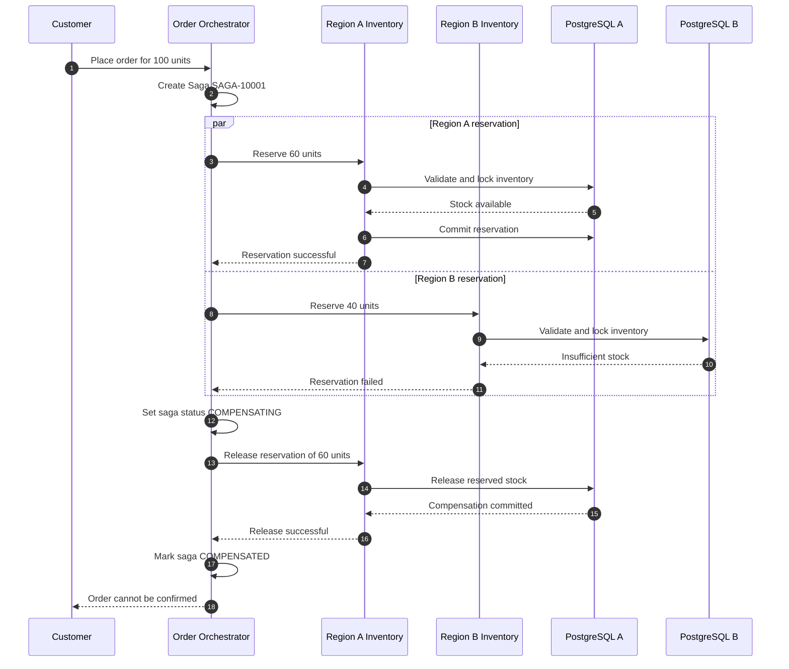
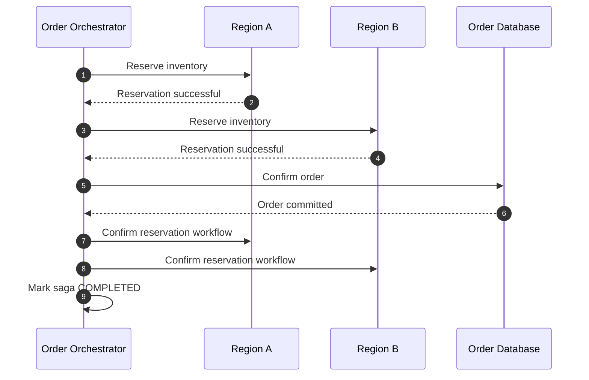

# RFC: Distributed Transaction Protocol for Cross-Region ERP Inventory Commitments

**RFC ID:** ERP-RFC-004  
**Status:** Proposed  
**Version:** 1.0  
**System:** Enterprise Supply Chain ERP  
**Difficulty:** Advanced  
**Decision:** Saga Pattern with local ACID transactions, reservation holds, transactional outbox, and compensating actions.

---

## 1. Abstract

The Enterprise Supply Chain ERP operates across geographically distributed warehouses and PostgreSQL inventory shards.

A customer order may require inventory from multiple warehouses located in different regions. The system must reserve stock at each warehouse, coordinate the overall order commitment, and recover safely if one or more regions become unavailable.

Traditional distributed transaction protocols such as Two-Phase Commit can provide atomic coordination but introduce significant latency and blocking risks across geographically distributed databases.

This RFC evaluates:

1. Two-Phase Commit (2PC).
2. Saga Pattern.
3. Percolator-style distributed transactions.

The recommended architecture uses the Saga Pattern with local PostgreSQL transactions, temporary inventory reservations, durable event publishing, idempotent operations, and compensating actions.

PostgreSQL remains the authoritative inventory store. Redis Cluster remains a read optimization layer and is never used to authorize stock reservations.

## 2. Problem Statement

Consider an order requiring 100 units of a product:

- Region A warehouse reserves 40 units.
- Region B warehouse reserves 35 units.
- Region C warehouse reserves 25 units.

The order should be confirmed only when all required reservations succeed.

However, several failures are possible:

- Region B becomes unavailable after Region A reserves stock.
- Region C rejects the reservation because inventory is insufficient.
- A coordinator crashes after receiving partial responses.
- Network delays cause duplicate reservation requests.
- Concurrent orders compete for the same inventory.
- A rollback message is delayed or delivered more than once.

The system must prevent overselling, avoid permanently locked inventory, and provide a recoverable order workflow.

## 3. Existing Architectural Context

This RFC builds upon the previously established ERP architecture.

| Component | Responsibility |
|---|---|
| FastAPI services | Order, inventory, and transaction APIs |
| PostgreSQL | Authoritative inventory and reservation records |
| Geographic sharding | Assigns each warehouse an authoritative database owner |
| Redis Cluster | High-frequency inventory read caching |
| Transactional outbox | Reliable publication of committed changes |
| CQRS | Separates transaction processing from read projections |
| Event processing | Synchronizes inventory changes between regions |
| Supplier routing | Selects suitable fulfillment warehouses |

### Architectural Constraints

1. Each warehouse has one authoritative inventory owner.
2. A warehouse must not allow another region to directly modify its inventory.
3. Every reservation must be validated against authoritative PostgreSQL data.
4. Distributed operations must be retryable and idempotent.
5. Failed workflows must release temporary reservations.
6. No global database transaction should remain open while waiting for remote regions.

## 4. Distributed Transaction Protocol Comparison

### 4.1 Two-Phase Commit (2PC)

Two-Phase Commit coordinates a transaction across multiple participants using a coordinator.

**Phase 1: Prepare**

- The coordinator sends PREPARE to all participating warehouses.
- Each warehouse validates stock availability.
- Each participant prepares its local transaction and holds necessary locks.
- Participants respond with READY or ABORT.

**Phase 2: Commit**

- If all participants vote READY, the coordinator sends COMMIT.
- Otherwise, the coordinator sends ABORT.
- Participants finalize the transaction.

#### Advantages

- Provides atomic transaction coordination across participants when correctly implemented.
- Prevents a partially committed distributed transaction.
- Suitable for workflows requiring all-or-nothing database updates.

#### Disadvantages

- Participants may hold locks while waiting for the coordinator.
- Network partitions can leave transactions in a prepared state.
- Coordinator failure may block transaction completion.
- Cross-region communication increases commit latency.
- Long-running order workflows are unsuitable for database locks held across remote operations.

#### ERP Suitability

2PC is not recommended as the default order fulfillment protocol because geographically distributed warehouse transactions may take too long and reduce availability during failures.

It may still be suitable for a small number of short-lived operations where true atomicity across databases is mandatory.

### 4.2 Saga Pattern

The Saga Pattern divides a distributed transaction into a sequence of independently committed local transactions.

Each successful operation has a corresponding compensating operation.

Example:

| Step | Region | Forward Action | Compensation |
|---|---|---|---|
| 1 | Region A | Reserve 40 units | Release 40 units |
| 2 | Region B | Reserve 35 units | Release 35 units |
| 3 | Region C | Reserve 25 units | Release 25 units |
| 4 | Order Service | Confirm order | Cancel order commitment if permitted |

If Region C fails, the workflow initiates compensating actions for Regions A and B.

Unlike database rollback, compensation is a new business transaction. It does not erase the original transaction history.

#### Advantages

- No distributed database locks are held throughout the workflow.
- Each region commits its own local transaction.
- Supports asynchronous execution.
- Works well with geographically distributed services.
- Provides explicit recovery and compensation logic.
- Supports retries and durable workflow state.

#### Disadvantages

- Compensation must be designed for every relevant operation.
- Temporary partial reservations may exist.
- Recovery can take time during network failures.
- The workflow is not globally atomic at every intermediate moment.
- Requires durable orchestration and idempotent handlers.

#### ERP Suitability

Saga is highly suitable for multi-warehouse reservations because each warehouse can independently validate and reserve its inventory while the order coordinator manages the overall workflow.

### 4.3 Percolator-Style Transactions

Percolator-style transactions use distributed storage coordination with mechanisms such as:

- Primary and secondary records.
- Prewrite phase.
- Commit phase.
- Transaction timestamps.
- Lock resolution.

The protocol is designed to coordinate transactions across distributed key-value storage systems.

#### Advantages

- Supports distributed transactional operations.
- Can provide consistent ordering through timestamp-based coordination.
- Avoids requiring a traditional centralized coordinator for every aspect of transaction processing.
- Useful for large distributed storage systems.

#### Disadvantages

- Requires specialized transaction and storage infrastructure.
- More complex than the current PostgreSQL-based architecture.
- Distributed lock resolution introduces operational complexity.
- Integration with independently owned PostgreSQL warehouse shards is not straightforward.
- Requires careful handling of transaction timestamps and conflict resolution.

#### ERP Suitability

Percolator-style transactions are not recommended for the current architecture because the ERP already uses independently owned PostgreSQL shards rather than one distributed transactional key-value storage engine.

## 5. Decision Matrix

Scores are qualitative from 1 (weak) to 5 (strong), based on the ERP requirements.

| Criterion | 2PC | Saga | Percolator-style |
|---|---:|---:|---:|
| Cross-region coordination | 4 | 5 | 4 |
| Local transaction support | 4 | 5 | 3 |
| Network partition resilience | 1 | 4 | 3 |
| Deadlock avoidance | 2 | 4 | 3 |
| Long-running workflow support | 1 | 5 | 3 |
| Compensation support | 2 | 5 | 2 |
| PostgreSQL integration | 4 | 5 | 2 |
| Operational simplicity | 2 | 4 | 1 |
| Performance under geographic latency | 2 | 4 | 3 |
| Overall ERP suitability | 2 | 5 | 2 |

### Decision

Select the Saga Pattern.

It aligns with the existing geographic ownership model, PostgreSQL transactions, asynchronous event propagation, and Redis caching strategy.

## 6. Proposed Architecture

The architecture contains the following components.

### 6.1 Order Orchestrator

A central workflow service manages the order's distributed reservation lifecycle.

Responsibilities:

- Create a unique saga ID.
- Determine the warehouse allocation plan.
- Track reservation progress.
- Dispatch reservation commands.
- Collect responses.
- Trigger compensation when required.
- Confirm the order only after all required reservations succeed.
- Persist workflow state for recovery.

The orchestrator coordinates the workflow but does not directly modify another warehouse's database.

### 6.2 Warehouse Inventory Services

Each warehouse exposes a reservation API.

Example:

```http
POST /api/inventory/reservations
```

Request:

```json
{
  "saga_id": "SAGA-10001",
  "order_id": "ORD-10001",
  "warehouse_id": "WH-BLR-01",
  "sku_id": "SKU-1001",
  "quantity": 40,
  "idempotency_key": "ORD-10001-WH-BLR-01"
}
```

Response:

```json
{
  "reservation_id": "RES-20001",
  "status": "RESERVED",
  "warehouse_id": "WH-BLR-01",
  "quantity": 40,
  "inventory_version": 109
}
```

### 6.3 PostgreSQL Reservation Model

Each warehouse maintains its own authoritative inventory and reservation records.

Suggested schema:

```sql
CREATE TABLE inventory_reservations (
    reservation_id UUID PRIMARY KEY,
    saga_id UUID NOT NULL,
    order_id UUID NOT NULL,
    warehouse_id VARCHAR(50) NOT NULL,
    sku_id VARCHAR(100) NOT NULL,
    quantity INTEGER NOT NULL CHECK (quantity > 0),
    status VARCHAR(20) NOT NULL,
    idempotency_key VARCHAR(150) NOT NULL UNIQUE,
    expires_at TIMESTAMP NOT NULL,
    created_at TIMESTAMP DEFAULT CURRENT_TIMESTAMP,
    updated_at TIMESTAMP DEFAULT CURRENT_TIMESTAMP
);
```

Suggested inventory columns:

```sql
ALTER TABLE warehouse_inventory
ADD COLUMN IF NOT EXISTS reserved_quantity INTEGER DEFAULT 0,
ADD COLUMN IF NOT EXISTS version BIGINT DEFAULT 0;
```

Available inventory should be calculated as:

```text
available_quantity = on_hand_quantity - reserved_quantity
```

The implementation must enforce non-negative available inventory through transactional validation and database constraints where appropriate.

## 7. Saga Execution Workflow

### Step 1: Create Order Saga

The order service creates a saga record.

Initial status:

```text
PENDING
```

A unique saga ID identifies the complete distributed workflow.

### Step 2: Generate Allocation Plan

The supplier and warehouse routing service determines the required allocation.

Example:

```text
Order: ORD-10001
Required quantity: 100

Region A: 40
Region B: 35
Region C: 25
```

The allocation plan is persisted before dispatching reservation commands.

### Step 3: Reserve Inventory

The orchestrator sends independent reservation requests to the warehouse owners.

Each warehouse:

1. Validates the request.
2. Checks the idempotency key.
3. Starts a PostgreSQL transaction.
4. Locks the relevant inventory row.
5. Verifies sufficient available stock.
6. Increases reserved quantity.
7. Creates the reservation record.
8. Inserts an outbox event.
9. Commits the transaction.

### Step 4: Confirm Order

If all required reservations succeed:

- The orchestrator marks the saga as READY_TO_COMMIT.
- The order service confirms the order.
- The saga status becomes COMPLETED.
- Warehouse reservation records remain active until fulfillment consumes them.

Order confirmation must itself be idempotent.

### Step 5: Compensate on Failure

If a required reservation fails:

- The orchestrator changes the saga status to COMPENSATING.
- It sends release commands for every successfully completed reservation.
- Each warehouse releases its reservation using a local transaction.
- The order is marked FAILED or REQUIRES_REVIEW.
- The saga is marked COMPENSATED after all required releases are confirmed.

If a compensation cannot be completed immediately, the saga remains in a recoverable compensation state and retries later.

## 8. Prototype Sequence Diagram

The following diagram illustrates a successful commit and a failure-triggered rollback across two regions.



### Successful Commit Flow

If both regions reserve successfully:



The order is not confirmed until all required reservations have succeeded.

## 9. Rollback and Compensation Strategies

Saga compensation is not a traditional SQL rollback.

Each compensation is a new transaction that reverses the business effect of a previously committed step.

| Forward Operation | Compensation |
|---|---|
| Reserve inventory | Release reservation |
| Allocate warehouse stock | Cancel allocation |
| Create shipment request | Cancel shipment if not dispatched |
| Confirm order | Cancel order if business rules permit |
| Create transfer request | Cancel transfer before dispatch |

### Compensation Rules

1. Compensation must be idempotent.
2. A reservation can be released only once.
3. Released inventory must be returned to available stock.
4. A completed shipment cannot be reversed by simply restoring stock.
5. Physical returns must create a separate inventory receipt transaction.
6. Every compensation must be auditable.
7. Compensation failures must remain visible and retryable.

### Reservation Expiration

Reservations should have an expiration timestamp.

Example:

```text
Reservation TTL: 10 minutes
```

If the order workflow does not complete before expiration:

- The reservation expires.
- Reserved quantity is released transactionally.
- The reservation status becomes EXPIRED.
- The saga is notified.
- The order cannot proceed using the expired reservation.

The TTL is a configurable example, not a fixed production requirement.

## 10. Failure-Mode Analysis

### Scenario 1: Network Partition Between Regions

**Failure:**

Region A cannot communicate with Region B.

**Risk:**

Region A reserves stock but cannot determine whether Region B completed its reservation.

**Recovery:**

- Keep the saga in WAITING or RECOVERING state.
- Do not confirm the order.
- Retry the request using the same idempotency key.
- Query the reservation status from Region B when connectivity returns.
- Resume the saga or initiate compensation based on the durable state.

A timeout is not proof that a remote transaction failed.

### Scenario 2: Orchestrator Crash

**Failure:**

The order orchestrator crashes after Region A reserves inventory.

**Risk:**

The order workflow remains incomplete while Region A holds stock.

**Recovery:**

- Persist saga state before dispatching operations.
- Persist each completed step.
- On restart, scan incomplete sagas.
- Query participant reservation status.
- Resume the workflow from the last durable state.
- Release expired or abandoned reservations.

### Scenario 3: Warehouse Database Crash

**Failure:**

Region B's PostgreSQL database becomes unavailable.

**Risk:**

The reservation operation cannot be validated or completed.

**Recovery:**

- Do not confirm the reservation based on Redis cache data.
- Retain the saga in a recoverable state.
- Retry when the authoritative database is available.
- Use PostgreSQL recovery and replication procedures.
- Verify the latest committed inventory version before accepting new reservations.

### Scenario 4: Concurrent Reservation Conflict

**Failure:**

Two orders attempt to reserve the same stock simultaneously.

Available stock: 20 units.

Order A requests 15 units.  
Order B requests 15 units.

**Risk:**

Both orders may read the same available quantity and oversell inventory.

**Recovery:**

- Use `SELECT FOR UPDATE` on the inventory row.
- Serialize conflicting stock mutations.
- Recheck available quantity inside the transaction.
- Commit only if sufficient stock remains.
- Reject or reroute the losing reservation.

Only one order should succeed if the warehouse has only 20 available units.

### Scenario 5: Duplicate Reservation Request

**Failure:**

A network timeout causes the orchestrator to retry an already successful request.

**Risk:**

The same stock is reserved twice.

**Recovery:**

- Use a unique idempotency key.
- Return the existing reservation result when the same request is repeated.
- Reject conflicting reuse of an idempotency key with different parameters.

### Scenario 6: Compensation Failure

**Failure:**

Region A cannot release a reservation after another region fails.

**Risk:**

Inventory remains unavailable unnecessarily.

**Recovery:**

- Persist the compensation command.
- Retry with bounded exponential backoff.
- Track compensation status.
- Alert operations if the reservation approaches expiration.
- Use an administrative recovery workflow for unresolved cases.

## 11. Deadlock Prevention

Distributed deadlocks and local database lock contention must be minimized.

### Recommended Controls

**1. No Remote Calls While Holding Database Locks**

Complete the local database transaction before publishing an event or calling another region.

**2. Deterministic Lock Ordering**

When a local operation modifies multiple inventory records, acquire locks in a consistent order, such as:

```text
warehouse_id ASC
sku_id ASC
```

**3. Short Transactions**

Keep PostgreSQL transactions limited to inventory validation, reservation updates, and outbox insertion.

**4. Lock Timeouts**

Configure reasonable database lock timeouts to prevent indefinite blocking.

**5. Idempotent Retries**

Retry transient failures using the same operation ID.

**6. Avoid Nested Distributed Transactions**

Do not start a new distributed transaction while another saga is waiting for compensation.

**7. Reservation Expiration**

Use expiration and recovery workers to release abandoned stock reservations.

## 12. Performance Impact Projections

The following values are illustrative estimates for design comparison, not benchmark results.

Assumptions:

- Two to three participating warehouse regions.
- Inter-region network RTT: 40–120 ms.
- Local PostgreSQL transaction: 5–15 ms.
- Peak workload: 500 distributed order workflows per second.
- Each order requires reservations from two or three warehouses.

### Estimated Coordination Overhead

| Protocol | Estimated Coordination Overhead | Locking Behavior |
|---|---|---|
| 2PC | 100–300+ ms | Participants may hold prepared locks |
| Saga | 10–30 ms local work per reservation, plus network and orchestration time | No cross-region database locks |
| Percolator-style | 80–250 ms depending on distributed storage topology | Distributed lock and timestamp coordination |

These estimates exclude external payment processing, shipping, and other unrelated business operations.

### Saga Workflow Latency

For a parallel reservation workflow across two regions:

```text
Local transaction A: 5–15 ms
Local transaction B: 5–15 ms
Inter-region communication: 40–120 ms
Orchestration and persistence: 5–20 ms
```

Approximate reservation phase:

```text
50–155 ms
```

A successful order workflow adds the order confirmation transaction and any subsequent fulfillment steps.

Parallel execution can reduce total latency compared with sequential reservation calls, provided that the allocation plan and compensation behavior are deterministic.

### Throughput Considerations

- Each warehouse independently processes local inventory transactions.
- Read-heavy traffic continues to use Redis.
- Cross-region events are processed asynchronously.
- The orchestrator should limit excessive concurrent workflows.
- Outbox publishing should use batching and backpressure.
- Reservation hot spots may require SKU-level partitioning or allocation policies.

Actual throughput must be established through load testing.

## 13. Monitoring and Recovery Metrics

Track the following metrics:

| Metric | Purpose |
|---|---|
| Active saga count | Detect workflow accumulation |
| Saga completion rate | Measure successful order commitments |
| Saga compensation rate | Identify reservation failures |
| Average saga duration | Detect coordination delays |
| Reservation conflict rate | Detect inventory contention |
| Expired reservation count | Identify abandoned stock holds |
| Outbox backlog | Detect event publishing delays |
| Compensation retry count | Detect recovery problems |
| Idempotency conflict count | Detect duplicate or conflicting requests |
| PostgreSQL lock wait time | Detect local contention |

Suggested alerts:

- Saga remains incomplete beyond its configured timeout.
- Compensation retries exceed the allowed threshold.
- Reservation expiration rate increases sharply.
- Outbox backlog exceeds the operational freshness objective.
- PostgreSQL lock waits exceed the expected range.

## 14. Security and Reliability

- Authenticate all inter-region service requests.
- Use encrypted communication between warehouse services.
- Validate warehouse ownership before accepting inventory commands.
- Ensure tenant and warehouse boundaries are enforced.
- Persist workflow state and operation identifiers.
- Use durable event publication.
- Apply bounded retries with exponential backoff and jitter.
- Protect the orchestrator against duplicate command execution.
- Keep audit records for reservations, releases, and order commitments.

## 15. Final Architectural Decision

Adopt the **Saga Pattern with an orchestration-based coordinator**.

The selected design uses:

1. Local ACID PostgreSQL transactions at each warehouse.
2. Temporary stock reservation records.
3. Unique saga and idempotency identifiers.
4. Transactional outbox event publication.
5. Compensating release operations.
6. Reservation expiration and recovery workers.
7. Durable orchestration state.
8. Redis Cluster for read optimization only.
9. CQRS projections for global inventory visibility.
10. Monitoring and reconciliation for incomplete workflows.

### Why Saga Is Selected

Two-Phase Commit introduces blocking and high coordination overhead when databases are geographically separated.

Percolator-style transactions require a distributed transactional storage architecture that does not match the existing PostgreSQL shard ownership model.

Saga fits the established architecture because it coordinates independent local transactions without holding database locks across regions.

### Final Decision Summary

| Design Area | Selected Approach |
|---|---|
| Distributed transaction protocol | Saga |
| Coordination style | Orchestration |
| Local transaction engine | PostgreSQL ACID |
| Inventory concurrency | Row-level locking and version checks |
| Event reliability | Transactional outbox |
| Retry protection | Idempotency keys |
| Failure recovery | Compensating transactions |
| Reservation cleanup | Expiration and recovery workers |
| Global inventory visibility | CQRS and eventual consistency |
| Cache | Redis Cluster |
| Cross-region ownership | Geographic warehouse authority |

## 16. Conclusion

The Saga Pattern provides the best balance of consistency, availability, performance, and recoverability for cross-region ERP inventory commitments.

Each warehouse remains responsible for its own inventory, and every reservation is validated through a local PostgreSQL transaction.

The order orchestrator coordinates the distributed workflow and uses compensating actions to release successful reservations when another region fails.

This approach avoids the long-lived distributed locks associated with Two-Phase Commit while maintaining strong local inventory correctness.

**Final recommendation:** Implement an orchestration-based Saga with durable workflow state, transactional outbox publishing, idempotent reservation commands, compensating release operations, and controlled reservation expiration.
