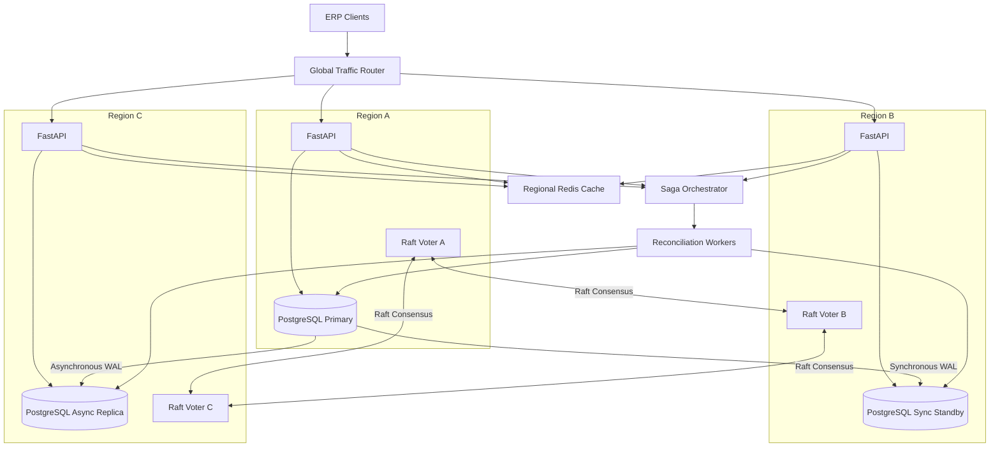
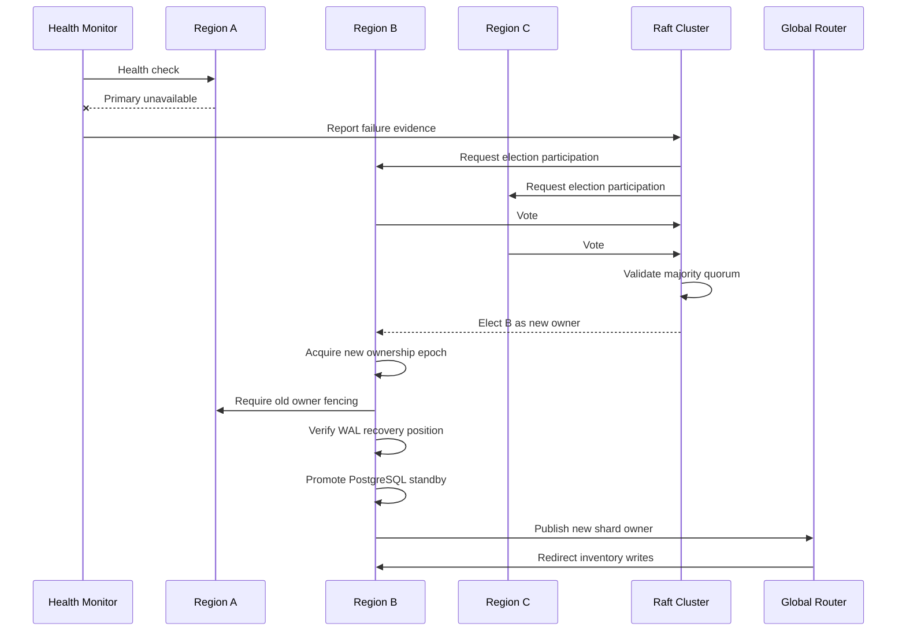
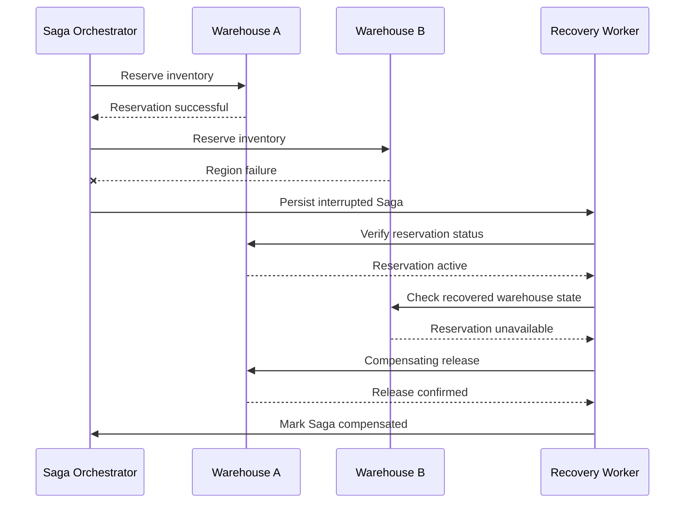

# Architecture Decision Record: Global ERP Inventory Failover and Consensus Recovery Policy

| Field | Value |
|---|---|
| Document Type | Architecture Decision Record |
| System | Global ERP Distributed Inventory |
| Status | Proposed – Ready for Review |
| Decision Area | Leader Election, Consensus, Failover, Recovery |
| Primary Technologies | Python, FastAPI, PostgreSQL |
| Consensus Protocol | Raft |
| Transaction Recovery | Saga Orchestration |
| Related Architecture | Multi-Region Sharding, WAL Replication, Disaster Recovery |

---

## 1. Executive Summary

This ADR defines the automated failover and consensus recovery policy for geographically distributed ERP inventory shards.

The ERP platform maintains inventory across multiple regions. Each warehouse shard has one authoritative write owner responsible for stock reservations, deductions, and inventory ledger updates.

Regional failures and network partitions introduce several risks:

- Two regions independently believing they own the same inventory shard.
- Loss of acknowledged inventory transactions during database promotion.
- Incomplete supply-chain reservations.
- Duplicate or delayed Saga events.
- Inconsistent inventory projections across regions.
- Conflicting leader election decisions.

To address these problems, this design adopts a three-region Raft-based consensus control plane combined with PostgreSQL WAL replication.

The selected architecture uses:

1. Three Raft voting members distributed across independent regions.
2. A two-of-three majority quorum for ownership changes.
3. PostgreSQL synchronous replication for critical acknowledged inventory commits.
4. Asynchronous replication for additional disaster recovery and read projections.
5. Monotonically increasing ownership epochs and fencing tokens.
6. Fail-closed behavior when consensus or data durability cannot be established.
7. Automated reconciliation and Saga compensation for interrupted supply-chain commitments.

The central architectural principle is that consensus authorizes shard ownership, while PostgreSQL provides durable inventory transactions.

Raft and PostgreSQL replication are complementary mechanisms, not interchangeable protocols.

---

## 2. Context and Existing Architecture

The existing ERP platform uses a geographically distributed inventory architecture.

| Component | Responsibility |
|---|---|
| FastAPI | Inventory, order, and reservation APIs |
| PostgreSQL | Authoritative inventory ledger |
| PostgreSQL WAL | Database replication and recovery |
| Redis Cluster | Regional read caching |
| Raft control plane | Leader election and ownership coordination |
| Transactional outbox | Reliable publication of committed events |
| Saga orchestrator | Cross-region transaction coordination |
| CQRS projections | Eventually consistent global inventory views |
| Reconciliation workers | Recovery of incomplete and inconsistent data |

### 2.1 Existing architecture decisions

The following decisions remain unchanged:

- One authoritative writer per warehouse shard.
- Active-passive ownership for critical ledger writes.
- Active-active application availability and safe read access.
- Hybrid consistency for local inventory and cross-region projections.
- Saga orchestration for multi-warehouse commitments.
- Redis is never an authoritative source of inventory availability.
- PostgreSQL remains the source of truth.

### 2.2 Problem statement

Consider a warehouse whose primary database is located in Region A, with standby databases in Regions B and C.

If Region A becomes unreachable:

- Region B may detect the primary failure.
- Region C may independently detect the same failure.
- The system must agree on which region is authorized to take ownership.
- The new owner must have a sufficiently complete inventory ledger.
- Pending reservations and supply-chain commitments must be recovered safely.

Without consensus and fencing, competing regions could accept conflicting inventory operations.

---

## 3. Evaluation of Leader Election Protocols

Three approaches were evaluated.

### 3.1 Raft Consensus

Raft elects a leader through majority voting and replicates consensus state through an ordered log.

Advantages:

- Understandable leader election model.
- Majority quorum prevents two independent majorities.
- Strong ordering of replicated control-plane decisions.
- Automatic leader replacement after failure.
- Suitable for ownership metadata and failover coordination.

Disadvantages:

- Requires a functioning majority quorum.
- WAN communication increases election and commit latency.
- Minority partitions cannot elect a new leader.
- Operational monitoring and quorum placement are essential.

### 3.2 Paxos-Based Consensus

Paxos provides consensus through proposer, acceptor, and learner roles.

Advantages:

- Strong theoretical foundation.
- Handles distributed failures.
- Suitable for highly reliable distributed coordination.

Disadvantages:

- More complex implementation and operational reasoning.
- More difficult to maintain and troubleshoot.
- Requires careful configuration of quorum and membership changes.

### 3.3 Lease-Based Leader Election

A lease-based design grants temporary ownership to one region.

Advantages:

- Relatively simple.
- Can reduce coordination overhead.
- Useful for time-limited ownership.

Disadvantages:

- Clock assumptions and lease expiration must be handled carefully.
- Network delays can create uncertainty.
- A stale owner may continue writing unless fencing is enforced.
- A lease by itself does not provide durable consensus.

### 3.4 Protocol comparison

Scoring: 1 = Poor, 3 = Moderate, 5 = Excellent.

| Criteria | Raft | Paxos | Lease-Based |
|---|---:|---:|---:|
| Leader election clarity | 5 | 3 | 4 |
| Split-brain resistance | 5 | 5 | 3 |
| Implementation simplicity | 4 | 2 | 5 |
| Fault tolerance | 5 | 5 | 3 |
| WAN suitability | 4 | 4 | 4 |
| Operational observability | 5 | 3 | 3 |
| Ownership coordination | 5 | 5 | 3 |
| **Total** | **33/35** | **27/35** | **25/35** |

### 3.5 Selected protocol

**Raft is selected for shard ownership and failover coordination.**

The Raft cluster will maintain:

- Current leader identity.
- Shard ownership mapping.
- Monotonically increasing ownership epochs.
- Failover authorization.
- Membership and configuration changes.
- Recovery and promotion state.

Raft will not directly replace PostgreSQL transaction processing or WAL replication.

---

## 4. Three-Region Consensus Architecture

### 4.1 Quorum design

Deploy three Raft voting members in independent regions.

| Region | Consensus Role | Inventory Role |
|---|---|---|
| Region A | Raft voter | Primary database |
| Region B | Raft voter | Synchronous standby |
| Region C | Raft voter | Asynchronous DR replica |

A majority of two out of three voters is required for a new ownership decision.

This provides tolerance for one unavailable voter, assuming the remaining voters can communicate and maintain quorum.

### 4.2 Quorum behavior

| Available Voters | Quorum | Ownership Changes |
|---|---|---|
| A, B, C | 2/3 | Allowed |
| A, B | 2/3 | Allowed |
| A, C | 2/3 | Allowed |
| B, C | 2/3 | Allowed |
| A only | 1/3 | Blocked |
| B only | 1/3 | Blocked |
| C only | 1/3 | Blocked |

A minority partition cannot authorize a new leader.

The Raft control plane must also use safe membership changes and persistent voting state. A recovered voter must not reuse stale election state.

### 4.3 Architecture diagram



The diagram represents logical responsibilities. Raft voters should be independently deployed and should not depend on the PostgreSQL primary they are responsible for coordinating.

PostgreSQL synchronous replication must be configured separately from the Raft cluster.

---

## 5. RPO and RTO Targets

The following are proposed engineering objectives. They require validation through deployment testing and measured WAN performance.

### 5.1 Recovery Point Objective

RPO measures the maximum acceptable loss of committed data following a failure.

| Data Category | Target RPO | Recovery Mechanism |
|---|---:|---|
| Acknowledged inventory ledger writes | 0 under synchronous durability | Remote WAL flush confirmation |
| Confirmed stock reservations | 0 under synchronous durability | Synchronous PostgreSQL replication |
| Transactional outbox | 0 under synchronous durability | Same database transaction as inventory change |
| Saga state transitions | 0 under synchronous durability | Durable replicated state |
| Global inventory projections | ≤ 5 minutes | Event replay |
| Analytics data | ≤ 15 minutes | Snapshot and event recovery |
| Redis cache | No durability guarantee | Rebuild from PostgreSQL |

A zero RPO guarantee applies only to writes acknowledged after the required synchronous standby has durably flushed the corresponding WAL.

If the synchronous standby is unavailable, the system must not silently acknowledge critical writes under an asynchronous durability policy.

### 5.2 Recovery Time Objective

| Failure Scenario | Target RTO | Action |
|---|---:|---|
| Application instance failure | ≤ 1 minute | Restart and reroute |
| Database process failure | ≤ 3 minutes | Local database recovery |
| Availability-zone failure | ≤ 5 minutes | Promote healthy local standby |
| Single-region outage | ≤ 15 minutes | Raft election and controlled promotion |
| Partial network partition | ≤ 10 minutes for safe ownership resolution | Quorum validation and fencing |
| Full two-region outage | ≤ 30 minutes, subject to recovery data availability | Restore surviving region and verify ledger |
| Projection recovery | ≤ 10 minutes after primary restoration | Replay outbox events |

These values are targets rather than guarantees. Recovery time depends on failure detection, quorum availability, database promotion, fencing, and recovery validation.

### 5.3 Partition-specific behavior

**Case A: Region A loses connectivity to B and C, while B and C can communicate.**

- A has no Raft majority.
- B and C retain two-of-three quorum.
- The new ownership decision can be made by B and C.
- A must be fenced before B accepts writes.
- B can be promoted only after verifying its database recovery point.

**Case B: Region A and B can communicate, but C is unavailable.**

- A and B retain quorum.
- Existing ownership remains valid.
- Normal operation can continue if the required synchronous data replica remains healthy.
- If the synchronous database path is unavailable, critical writes pause.

**Case C: All three regions lose connectivity to one another.**

- No region can obtain a majority.
- No new ownership decision is permitted.
- Critical writes are rejected or paused.
- Last-known read projections may remain available with stale-data indicators.

**Case D: Region A fails completely, but B and C remain connected.**

- B and C establish quorum.
- The old primary is confirmed fenced.
- B is promoted only if it contains the required acknowledged WAL.
- Traffic is redirected after ownership is established.

---

## 6. Split-Brain Mitigation

Split-brain occurs when two regions independently accept writes for the same inventory shard.

The system uses multiple layers of protection.

### 6.1 Ownership epochs

Every ownership change increments the shard's epoch.

Example:

| Event | Region | Epoch | Write Authorization |
|---|---|---:|---|
| Normal operation | A | 101 | Allowed |
| Failover initiated | A | 101 | Revoked |
| New owner elected | B | 102 | Allowed |
| Old region recovers | A | 101 | Rejected |

Each inventory write request must carry the current ownership epoch.

Example:

```json
{
  "warehouse_id": "WH-101",
  "operation": "reserve_stock",
  "ownership_epoch": 102,
  "idempotency_key": "ORD-9001-WH101-RESERVE"
}
```

The API validates the epoch before executing the operation.

### 6.2 Fencing mechanisms

Before promoting a new primary:

1. Confirm that the old primary is stopped or isolated.
2. Revoke old write credentials or network access.
3. Prevent the old primary from accepting storage writes.
4. Obtain a new ownership epoch through Raft.
5. Verify the candidate replica's recovery position.
6. Promote the candidate database.
7. Update routing and write authorization.
8. Perform controlled health checks.

A lease expiration alone is not sufficient. Infrastructure-level fencing is required.

### 6.3 Write authorization

A critical inventory mutation must pass all of the following checks:

- The target region is the authorized shard owner.
- The ownership epoch is current.
- The database is writable.
- The required durability condition is satisfied.
- The request has a valid idempotency key.

If any check fails, the operation is rejected.

### 6.4 Fail-closed policy

If the system cannot prove that one region owns the shard, it must not accept critical inventory mutations.

This prevents duplicate stock allocation and overselling during uncertain network conditions.

---

## 7. Automated Leader Election and Failover

### 7.1 Failure detection

The monitoring layer checks:

- PostgreSQL availability.
- Raft heartbeat health.
- Leader lease and election state.
- WAL replication lag.
- Synchronous standby health.
- Regional network reachability.
- API error rates.
- Ownership epoch validity.

A single failed health check must not trigger automatic regional promotion.

### 7.2 Leader election workflow



### 7.3 Promotion conditions

Automatic promotion is allowed only when:

- A valid Raft majority exists.
- The old primary is fenced.
- The candidate database is eligible for promotion.
- The candidate contains all required acknowledged transactions.
- A new ownership epoch has been committed.
- Database and API health checks pass.

If these conditions cannot be met, the shard enters recovery mode and critical writes remain disabled.

---

## 8. PostgreSQL Replication Strategy

Raft coordinates ownership; PostgreSQL WAL replication protects inventory data.

### 8.1 Replication topology

| Database | Region | Replication Mode | Purpose |
|---|---|---|---|
| Primary | A | Primary | Authoritative inventory writes |
| Standby | B | Synchronous | Critical commit durability |
| DR Replica | C | Asynchronous | Additional disaster recovery |

### 8.2 Synchronous replication

For critical inventory writes:

- The primary commits the transaction.
- WAL is sent to the synchronous standby.
- The standby confirms durable WAL receipt.
- The primary acknowledges the commit.

This supports zero RPO for acknowledged writes under the stated replication assumptions.

The synchronous commit policy should be configured explicitly and verified against the deployed PostgreSQL version and failover tooling.

### 8.3 Asynchronous replication

The additional disaster-recovery replica receives WAL asynchronously.

Advantages:

- Lower primary write latency.
- Greater regional flexibility.
- Additional recovery capability.

Disadvantage:

- Recent transactions may be missing at promotion time.

The asynchronous replica must not be promoted as if it had zero data loss. Its WAL position must be compared against the last known acknowledged recovery point.

### 8.4 Important limitation

A Raft majority does not prove that a PostgreSQL standby contains every acknowledged inventory transaction.

Consensus quorum and database durability must be verified independently before promotion.

---

## 9. Automated Recovery of Supply-Chain Commitments

Cross-region supply-chain orders continue to use the previously selected orchestration-based Saga pattern.

A regional outage may interrupt a Saga after some warehouses have reserved stock but before the overall order has been confirmed.

### 9.1 Recovery workflow



### 9.2 Saga recovery rules

| Saga State | Recovery Action |
|---|---|
| Order created | Resume allocation |
| No inventory reserved | Retry reservation |
| One warehouse reserved | Verify before retrying other warehouses |
| Multiple reservations partially successful | Resume or compensate |
| All reservations completed | Resume order confirmation |
| Compensation incomplete | Retry idempotently |
| Reservation expired | Mark expired and reconcile |
| Event delivery uncertain | Query durable event and transaction state |

### 9.3 Idempotency

Every reservation and compensation request must use a stable idempotency key.

Example:

```text
ORD-9001:WH-101:RESERVE
ORD-9001:WH-101:RELEASE
```

Repeated requests must not create duplicate reservations or release stock more than once.

### 9.4 Compensation transaction logic

If a regional outage prevents an order from being fulfilled:

1. Recover the durable Saga state.
2. Query the authoritative warehouse database.
3. Identify confirmed reservations.
4. Release reservations that are no longer required.
5. Persist each compensation result.
6. Retry failed compensations safely.
7. Mark the Saga complete only when all required recovery actions are resolved.

Compensation is a new business transaction, not a rollback of previously committed database history.

---

## 10. Automated Data Reconciliation

Post-failover reconciliation compares:

- Promoted primary inventory records.
- Recovered former-primary records.
- Reservation state.
- Transactional outbox records.
- Saga orchestration state.
- Cross-region projections.

### 10.1 Reconciliation phases

**Phase 1: Establish authority**

- Verify the current Raft leader.
- Verify the ownership epoch.
- Confirm old-primary fencing.
- Record the recovered WAL position.

**Phase 2: Compare inventory records**

Compare records using:

- Warehouse ID.
- Product ID.
- Inventory version.
- Physical stock.
- Reserved stock.
- Ledger transaction sequence.

**Phase 3: Validate ledger invariants**

Check that:

- Stock balances are non-negative.
- Reserved stock does not exceed physical stock.
- Every confirmed reservation has a corresponding ledger transaction.
- No event ID is processed more than once.
- Inventory versions are monotonic.

**Phase 4: Recover events**

- Identify undelivered outbox events.
- Replay missing events.
- Ignore duplicate events.
- Preserve per-aggregate event ordering.
- Reject unverified stale-owner events.

**Phase 5: Recover Saga state**

- Resume interrupted commitments.
- Verify existing reservations.
- Retry idempotent operations.
- Compensate failed or expired commitments.

**Phase 6: Rebuild projections**

- Refresh CQRS projections.
- Invalidate affected Redis keys.
- Rebuild regional caches from authoritative data.
- Verify projection versions.

**Phase 7: Generate recovery report**

Record:

- Current ownership epoch.
- Recovered database region.
- Last known durable WAL position.
- Number of records compared.
- Number of mismatches.
- Number of events replayed.
- Number of Saga workflows recovered.
- Number of compensation operations completed.

### 10.2 Python reconciliation prototype

The following prototype compares two inventory snapshots and identifies discrepancies without blindly overwriting authoritative records.

```python
from dataclasses import dataclass
from typing import Dict, List, Tuple


@dataclass
class InventoryRecord:
    warehouse_id: str
    product_id: str
    physical_stock: int
    reserved_stock: int
    version: int


@dataclass
class ReconciliationResult:
    checked: int
    mismatches: List[dict]
    invalid_records: List[dict]


def index_records(
    records: List[InventoryRecord],
) -> Dict[Tuple[str, str], InventoryRecord]:
    return {
        (record.warehouse_id, record.product_id): record
        for record in records
    }


def reconcile_inventory(
    authoritative_records: List[InventoryRecord],
    recovered_records: List[InventoryRecord],
) -> ReconciliationResult:

    authoritative = index_records(authoritative_records)
    recovered = index_records(recovered_records)

    mismatches = []
    invalid_records = []

    for key, current in authoritative.items():

        replica = recovered.get(key)

        if current.physical_stock < 0:
            invalid_records.append({
                "record": key,
                "reason": "Negative physical stock",
            })

        if current.reserved_stock < 0:
            invalid_records.append({
                "record": key,
                "reason": "Negative reserved stock",
            })

        if current.reserved_stock > current.physical_stock:
            invalid_records.append({
                "record": key,
                "reason": "Reserved stock exceeds physical stock",
            })

        if replica is None:
            mismatches.append({
                "record": key,
                "reason": "Missing from recovered replica",
            })
            continue

        if current.version != replica.version:
            mismatches.append({
                "record": key,
                "reason": "Version mismatch",
                "authoritative_version": current.version,
                "recovered_version": replica.version,
            })

        if (
            current.physical_stock != replica.physical_stock
            or current.reserved_stock != replica.reserved_stock
        ):
            mismatches.append({
                "record": key,
                "reason": "Quantity mismatch",
            })

    for key in recovered.keys() - authoritative.keys():
        mismatches.append({
            "record": key,
            "reason": "Record exists only in recovered replica",
        })

    return ReconciliationResult(
        checked=len(authoritative),
        mismatches=mismatches,
        invalid_records=invalid_records,
    )


def print_report(result: ReconciliationResult):

    print("GLOBAL INVENTORY RECONCILIATION")
    print("--------------------------------")

    print(f"Records checked: {result.checked}")
    print(f"Mismatches: {len(result.mismatches)}")
    print(f"Invalid records: {len(result.invalid_records)}")

    for item in result.mismatches:
        print("MISMATCH:", item)

    for item in result.invalid_records:
        print("INVALID:", item)

    if not result.mismatches and not result.invalid_records:
        print("Status: RECONCILIATION CLEAN")
    else:
        print("Status: CONTROLLED RECOVERY REQUIRED")


if __name__ == "__main__":

    primary = [
        InventoryRecord("WH-101", "SKU-1", 100, 20, 12),
        InventoryRecord("WH-101", "SKU-2", 50, 10, 8),
    ]

    recovered = [
        InventoryRecord("WH-101", "SKU-1", 100, 20, 12),
        InventoryRecord("WH-101", "SKU-2", 50, 8, 7),
    ]

    result = reconcile_inventory(primary, recovered)

    print_report(result)
```

This prototype is a validation component, not a production database repair tool. A production implementation must use database transactions, ownership checks, ledger history, and idempotency controls before applying any repair.

---

## 11. Security and Compliance

The consensus and recovery system must enforce:

- Mutual TLS for inter-region communication.
- Authenticated Raft member communication.
- Encryption at rest for PostgreSQL data and backups.
- Least-privilege database permissions.
- Separate roles for replication and inventory mutations.
- Restricted ownership-controller privileges.
- Audit records for every election and promotion.
- Secure storage of replication credentials.
- Periodic backup restore verification.
- Region-specific retention and residency policies.

### Data residency

Inventory and supply-chain data may be subject to regional data residency requirements.

The architecture must therefore:

1. Keep authoritative warehouse records in their permitted geographic region.
2. Replicate sensitive data only to approved recovery regions.
3. Use data minimization for global projections.
4. Avoid copying restricted customer or supplier information into unauthorized regions.
5. Maintain region-specific backup retention and deletion policies.

Consensus metadata should contain only the minimum information necessary for ownership coordination.

A region must not become a replica or primary for data it is not authorized to store.

---

## 12. Monitoring and Operational Metrics

| Metric | Purpose | Alert Condition |
|---|---|---|
| Raft quorum health | Detect loss of consensus | Fewer than 2 voters available |
| Election duration | Measure leader recovery | Exceeds configured election target |
| Current ownership epoch | Detect stale owners | Unexpected or outdated epoch |
| PostgreSQL replication lag | Measure replica freshness | Exceeds configured RPO budget |
| WAL replay position | Validate promotion candidate | Missing acknowledged transactions |
| Failover duration | Measure RTO | Exceeds 15-minute target |
| Saga recovery backlog | Detect interrupted commitments | Sustained backlog growth |
| Outbox delivery lag | Detect delayed events | Exceeds operational threshold |
| Inventory mismatch count | Detect data drift | Any unexplained mismatch |
| Compensation failure count | Detect incomplete recovery | Any persistent failure |

All metrics should be observable by warehouse shard and region.

---

## 13. Disaster Recovery Validation Plan

| Test Scenario | Expected Result |
|---|---|
| Stop Region A Raft voter | Remaining two voters maintain quorum |
| Isolate Region A from B and C | Minority cannot authorize ownership |
| Stop PostgreSQL primary | Controlled promotion after fencing |
| Introduce WAL replication lag | Promotion checks recovery point |
| Restart former primary | Old ownership epoch is rejected |
| Duplicate Saga event | Event processed idempotently |
| Interrupt multi-warehouse reservation | Recovery worker resumes or compensates |
| Remove one Raft voter | Cluster continues with two voters |
| Remove two Raft voters | No new ownership decision is permitted |
| Simulate full regional outage | Surviving quorum and eligible replica determine recovery |
| Corrupt a projection | Projection rebuilt from authoritative events |
| Clear Redis cache | Cache reconstructed from PostgreSQL |

Every test must record:

- Failure detection time.
- Election completion time.
- Database promotion time.
- Actual data loss or RPO.
- Total service recovery time.
- Reconciliation duration.
- Number of recovered or compensated commitments.

---

## 14. Consequences and Trade-offs

### Positive consequences

- Prevents independent regions from authorizing conflicting ownership.
- Provides predictable leader election through Raft.
- Protects acknowledged inventory commits through synchronous replication.
- Enables controlled recovery after regional outages.
- Supports idempotent Saga recovery.
- Detects inventory drift through automated reconciliation.
- Preserves the existing PostgreSQL and FastAPI architecture.

### Negative consequences

- Raft quorum loss prevents new ownership changes.
- WAN latency increases consensus and synchronous replication overhead.
- Critical writes may pause during network partitions.
- Running three independent consensus members increases infrastructure costs.
- Failover requires reliable infrastructure-level fencing.
- Reconciliation and Saga recovery introduce operational complexity.

### Accepted trade-off

The system prioritizes inventory correctness and transaction durability over unrestricted write availability during severe network partitions.

Read access and independent warehouse operations may continue where safe, but a shard cannot accept critical writes without a verified owner and the required durability guarantees.

---

## 15. Final Architecture Decision

**Decision: Adopt a three-region Raft-based consensus control plane with a two-of-three quorum, combined with PostgreSQL WAL replication and active-passive inventory ownership.**

The final design includes:

1. Three geographically independent Raft voters.
2. A two-of-three quorum for leader election and ownership changes.
3. One authorized write owner per warehouse shard.
4. Synchronous PostgreSQL replication for critical acknowledged inventory writes.
5. Asynchronous replication for additional disaster recovery.
6. Monotonically increasing ownership epochs.
7. Infrastructure-enforced fencing before promotion.
8. Fail-closed behavior when quorum or data durability cannot be verified.
9. Automated inventory reconciliation and event replay.
10. Saga recovery and compensation for interrupted supply-chain commitments.

### Decision summary

| Area | Selected Approach |
|---|---|
| Consensus | Raft |
| Voter count | 3 |
| Quorum | 2 of 3 |
| Write topology | Active-Passive per shard |
| Inventory database | PostgreSQL |
| Critical replication | Synchronous WAL |
| Additional DR replication | Asynchronous WAL |
| Split-brain protection | Fencing + ownership epochs |
| Critical write RPO | 0 under synchronous durability |
| Projection RPO | ≤ 5 minutes |
| Regional failover RTO | ≤ 15 minutes |
| Partition policy | Fail closed without verified ownership |
| Transaction recovery | Saga orchestration |
| Reconciliation | Automated comparison and controlled repair |

---

## 16. Conclusion

The proposed consensus recovery policy provides a controlled mechanism for maintaining global ERP inventory correctness during regional outages and network partitions.

Raft establishes a single authorized shard owner through majority consensus. PostgreSQL WAL replication ensures that the promoted database has the required durable transaction history. Ownership epochs and infrastructure-enforced fencing prevent a recovered former primary from accepting stale writes.

Interrupted supply-chain commitments are recovered through durable Saga state, idempotent retries, reservation verification, and compensating transactions.

The design integrates with the previously established multi-region replication, hybrid consistency, caching, and disaster recovery architecture.

**Final principle: Consensus determines who may write, PostgreSQL determines what has been durably committed, and Saga determines how interrupted business operations recover.**
