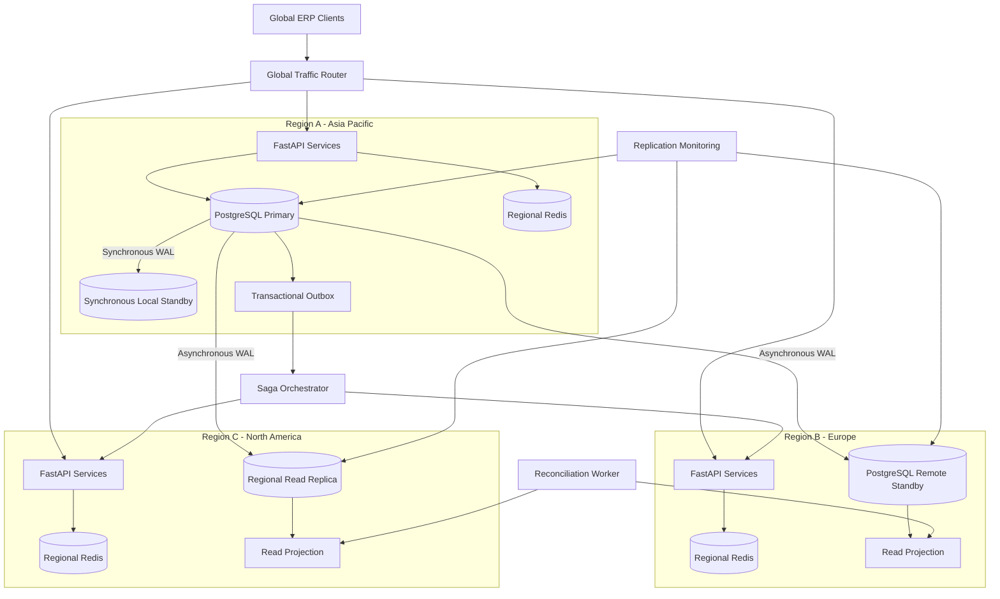
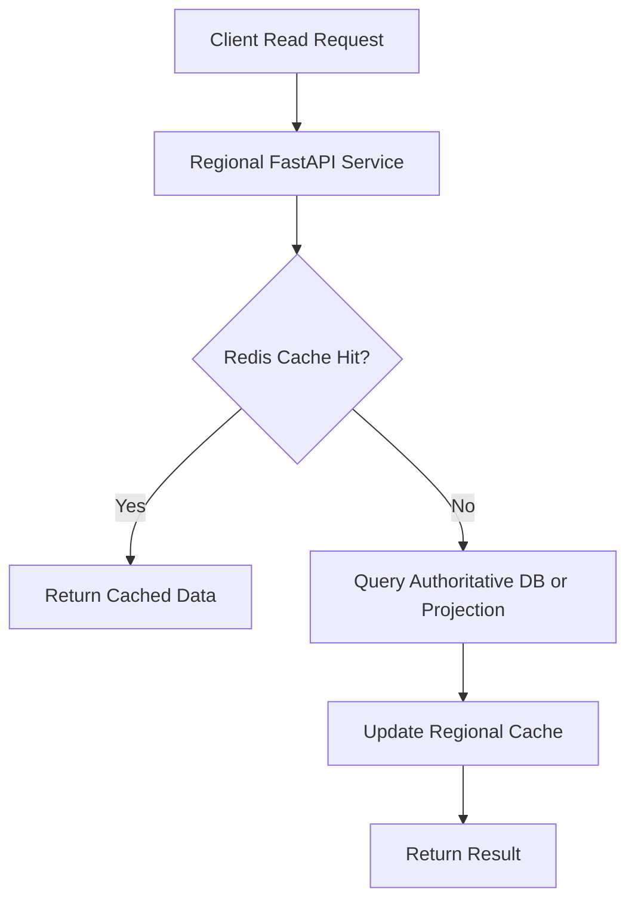

# Architecture Decision Record: Cross-Region Latency Mitigation and Data Replication Topologies for Global ERP Shards

| Field | Value |
|---|---|
| Document Type | Architecture Decision Record (ADR) |
| System | Enterprise Resource Planning – Global Distributed Inventory |
| Status | Proposed – Ready for Review |
| Decision Area | Cross-Region Replication and Latency Optimization |
| Related Architecture | Warehouse Sharding, Redis Caching, Hybrid Consistency, Saga Transactions, Disaster Recovery |
| Primary Technologies | Python, FastAPI, PostgreSQL, Redis |
| Difficulty | Advanced |

---

## 1. Executive Summary

This ADR evaluates cross-region data replication topologies and latency mitigation strategies for a geographically distributed ERP inventory system.

The system operates across multiple enterprise regions, each managing warehouse inventory through geographically partitioned PostgreSQL shards.

The primary architectural challenge is balancing:

- Low write latency for geographically distributed users.
- High availability during regional failures.
- Strong consistency for inventory reservations and stock deductions.
- Reliable cross-region data replication.
- Protection against split-brain and inventory overselling.
- Compliance with regional data residency requirements.

Three replication strategies are evaluated:

1. Fully synchronous cross-region replication.
2. Fully asynchronous cross-region replication.
3. Hybrid synchronous and asynchronous replication.

### Final decision

**Adopt a hybrid replication topology with active-passive write ownership per warehouse shard.**

The selected architecture uses:

- Synchronous PostgreSQL replication between availability zones within a region.
- Asynchronous PostgreSQL WAL replication to a standby region for normal operations.
- Synchronous remote durability for designated critical inventory commitments when zero-RPO acknowledgment is required.
- Transactional outbox events for reliable cross-region application-level synchronization.
- Regional Redis caches and read replicas to reduce read latency.
- WAN optimization, connection pooling, batching, and controlled event replay.

Each warehouse shard retains one authoritative write owner. Cross-region replication does not create independent writers for the same inventory ledger.

---

## 2. Context and Existing Architecture

The existing ERP system has evolved through several architecture decisions.

| Existing Component | Responsibility |
|---|---|
| FastAPI services | Inventory, reservation, order, and orchestration APIs |
| PostgreSQL | Authoritative inventory ledger |
| Warehouse shards | Geographical inventory partitioning |
| Redis Cluster | Distributed read caching |
| Transactional outbox | Reliable event publication |
| Saga orchestrator | Cross-region inventory commitments |
| CQRS projections | Eventually consistent global inventory views |
| Ownership controller | Regional failover and shard ownership |
| Reconciliation workers | Post-failover data verification |

### 2.1 Existing consistency decisions

The previous architecture established:

1. One authoritative write owner per warehouse shard.
2. Strong consistency for local inventory reservations and deductions.
3. Eventual consistency for global inventory projections.
4. Active-passive ownership for critical inventory writes.
5. Redis as a disposable cache rather than an inventory authority.
6. Saga orchestration for multi-region commitments.
7. Ownership epochs and fencing tokens to prevent split-brain.

The replication topology selected in this ADR must preserve these guarantees.

### 2.2 Problem statement

Consider an ERP deployment with three regions:

- Region A: Asia-Pacific.
- Region B: Europe.
- Region C: North America.

A customer in Europe may request inventory managed by an Asia-Pacific warehouse.

If every request requires multiple synchronous cross-region database operations, network round-trip latency can significantly increase response time.

However, relying entirely on asynchronous replication introduces a risk that recently acknowledged inventory changes may not yet exist in the standby region during a failure.

The architecture must therefore distinguish between:

- Critical inventory ledger operations.
- Non-critical metadata and reporting updates.
- Read-heavy global inventory queries.
- Cross-region event propagation.

---

## 3. Replication Topology Evaluation

### 3.1 Option A: Fully synchronous cross-region replication

In synchronous replication, a transaction waits for the required standby acknowledgment before the primary confirms the commit.

**Advantages**

- Stronger cross-region durability guarantees.
- Reduced risk of losing acknowledged transactions.
- Easier recovery-point management.
- Suitable for critical inventory commitments.

**Disadvantages**

- Write latency depends on WAN round-trip time.
- Regional network interruptions can block commits.
- Reduced write availability during partitions.
- Higher operational and infrastructure complexity.

A geographically distant standby can add tens or hundreds of milliseconds to the critical transaction path.

### 3.2 Option B: Fully asynchronous cross-region replication

In asynchronous replication, the primary commits locally and sends WAL records to the standby without waiting for remote acknowledgment.

**Advantages**

- Lower primary write latency.
- Better write availability during temporary WAN interruptions.
- Suitable for analytics, reporting, and read projections.
- Less sensitivity to intercontinental network latency.

**Disadvantages**

- Replication lag can cause recent transactions to be absent from the standby.
- Failover may lose transactions not yet replicated.
- Recovery requires reconciliation and event replay.
- A strict zero-RPO guarantee cannot be claimed.

This approach is unsuitable as the sole durability mechanism for critical inventory commitments requiring zero acknowledged data loss.

### 3.3 Option C: Hybrid replication

The hybrid model combines local synchronous replication with cross-region asynchronous replication.

Critical operations can additionally request synchronous remote durability.

**Advantages**

- Low latency for most local writes.
- Strong local database availability.
- Cross-region disaster recovery capability.
- Selective protection for critical transactions.
- Flexible handling of reporting and projection workloads.

**Disadvantages**

- More complex replication configuration.
- Requires transaction classification.
- Requires clear policies for degraded operation.
- Requires monitoring of WAL lag and remote durability.

### 3.4 Replication trade-off matrix

Scoring: 1 = Poor, 3 = Moderate, 5 = Excellent.

| Evaluation Criteria | Fully Synchronous | Fully Asynchronous | Hybrid |
|---|---:|---:|---:|
| Critical data durability | 5 | 2 | 5 |
| Local write latency | 2 | 5 | 4 |
| Regional write availability | 2 | 5 | 4 |
| Network partition tolerance | 2 | 5 | 4 |
| Operational simplicity | 3 | 4 | 2 |
| Disaster recovery capability | 5 | 3 | 5 |
| Reporting scalability | 3 | 5 | 5 |
| Flexibility | 2 | 3 | 5 |
| **Total** | **24/40** | **32/40** | **34/40** |

### 3.5 Selected approach

**Hybrid replication is selected.**

It provides a balance between low-latency operations and reliable inventory durability.

The architecture does not force every reporting or metadata transaction to wait for a remote region. Instead, replication behavior is selected according to the business criticality of the operation.

---

## 4. Proposed Cross-Region Replication Topology

### 4.1 Logical architecture



### 4.2 Regional ownership model

Each warehouse shard has a designated primary region.

| Warehouse Shard | Primary Region | Standby Region | Write Authority |
|---|---|---|---|
| WH-ASIA | Asia-Pacific | Europe | Asia-Pacific |
| WH-EUROPE | Europe | North America | Europe |
| WH-NORTH-AMERICA | North America | Asia-Pacific | North America |

Different warehouse shards can have different primary regions.

A regional database may be a primary for its own warehouse shards and a standby or read replica for another region's shards.

This allows regional independence without creating multi-writer conflicts for the same inventory records.

### 4.3 Replication layers

**Layer 1: Local synchronous replication**

Each regional primary maintains a synchronous standby within the same region or availability-zone failure domain.

Purpose:
- Protect against local database or infrastructure failure.
- Reduce local recovery time.
- Avoid unnecessary WAN latency for ordinary transactions.

**Layer 2: Cross-region asynchronous replication**

WAL records are continuously transferred to the designated standby region.

Purpose:
- Support regional disaster recovery.
- Maintain a recoverable copy of the inventory ledger.
- Reduce normal write latency.

**Layer 3: Selective synchronous remote durability**

For designated critical inventory commitments, the transaction can wait for a remote standby to durably flush the required WAL record before acknowledgment.

Purpose:
- Protect high-value or explicitly zero-RPO transactions.
- Reduce acknowledged transaction loss during regional failure.

This mode must be explicitly configured and monitored. It is not assumed to apply automatically to every database transaction.

---

## 5. Transaction Classification and Replication Policy

Different ERP operations have different durability and latency requirements.

| Transaction Type | Replication Policy | Consistency Requirement |
|---|---|---|
| Inventory reservation | Local synchronous; remote synchronous when zero-RPO is required | Strong |
| Stock deduction | Local synchronous; remote synchronous when zero-RPO is required | Strong |
| Inventory adjustment | Local synchronous; remote durability according to business criticality | Strong |
| Order metadata | Local commit and asynchronous replication | Eventual |
| Product catalog updates | Asynchronous replication | Eventual |
| Global reporting | Asynchronous projection updates | Eventual |
| Analytics events | Asynchronous event streaming | Eventual |
| Dashboard inventory reads | Regional cache or projection | Bounded staleness |

### 5.1 Critical write behavior

A critical inventory reservation must:

1. Reach the authoritative warehouse PostgreSQL primary.
2. Validate available stock within a local transaction.
3. Acquire the appropriate row-level lock.
4. Create the reservation and corresponding outbox event.
5. Commit the database transaction.
6. Wait for the configured durability acknowledgment.
7. Return success only after the required commit condition is satisfied.

For a transaction configured with remote synchronous durability, success is returned only after the remote standby has durably acknowledged the relevant WAL record.

### 5.2 PostgreSQL configuration considerations

Illustrative configuration for local synchronous replication:

```ini
wal_level = replica
max_wal_senders = 10
max_replication_slots = 10

synchronous_standby_names = 'FIRST 1 (local_standby)'
synchronous_commit = on
```

For a transaction that requires remote durability, the deployment can use a separate connection or transaction policy that includes an eligible remote synchronous standby.

For example:

```sql
SET LOCAL synchronous_commit = 'on';
```

The actual synchronous standby selection must be configured and verified at the PostgreSQL deployment level.

`remote_apply` may be used when the application specifically requires the remote standby to replay the transaction before acknowledgment, but it generally adds more latency than waiting for durable WAL flush.

**Important:** PostgreSQL synchronous replication configuration is not a substitute for fencing or shard ownership control. A standby must not be independently promoted while the previous primary can still accept writes.

---

## 6. Quantitative Latency Benchmarks

The following figures are illustrative planning assumptions for a three-region deployment. They are not measured production benchmarks.

### 6.1 Network assumptions

| Parameter | Assumed Value |
|---|---:|
| Local application-to-database RTT | 1–3 ms |
| Same-region synchronous standby RTT | 2–8 ms |
| Asia-Pacific to Europe WAN RTT | 100–150 ms |
| Asia-Pacific to North America WAN RTT | 150–220 ms |
| Europe to North America WAN RTT | 80–120 ms |
| Redis regional cache lookup | 1–3 ms |
| Local PostgreSQL transaction processing | 5–15 ms |
| Expected peak API load | 5,000 requests/second |
| Inventory write workload | 500 writes/second |
| Read-to-write ratio | 90:10 |

### 6.2 Estimated write latency

| Write Strategy | Estimated Commit Latency |
|---|---:|
| Local PostgreSQL commit | 5–15 ms |
| Local synchronous replication | 8–25 ms |
| Cross-region asynchronous replication | 5–20 ms primary acknowledgment, with remote lag |
| Remote synchronous durability, Asia-Europe | 105–175 ms |
| Remote synchronous durability, Asia-North America | 155–245 ms |

These estimates exclude application processing, client network latency, retries, and queueing under heavy load.

### 6.3 Estimated read latency

| Read Strategy | Estimated Latency |
|---|---:|
| Regional Redis cache hit | 1–3 ms |
| Local PostgreSQL read | 5–15 ms |
| Same-region read replica | 8–25 ms |
| Cross-region database read | 100–220 ms |
| Regional CQRS projection | 5–20 ms |

The architecture should route ordinary dashboard and catalog reads to regional caches or projections instead of making every request cross the WAN.

### 6.4 Peak throughput projections

Assume a workload of 5,000 API requests per second with 500 inventory writes per second.

| Workload | Estimated Peak Throughput | Strategy |
|---|---:|---|
| Regional cached reads | 4,000–4,500 requests/sec | Redis |
| Local database reads | 500–1,000 requests/sec | PostgreSQL |
| Local inventory writes | 500 writes/sec target | PostgreSQL primary |
| Cross-region event delivery | 500–1,500 events/sec capacity target | Outbox workers |
| Projection updates | 500–1,500 updates/sec capacity target | Regional consumers |

These are capacity-planning targets, not guaranteed PostgreSQL or Redis throughput. Actual throughput must be established through workload-specific load testing.

### 6.5 Latency optimization objective

The target is to keep:

- Regional cache reads below 5 ms under normal conditions.
- Local inventory writes below 30 ms at the database layer under normal conditions.
- Ordinary cross-region asynchronous replication outside the synchronous request path.
- Critical remote-durable inventory commits within a region-specific latency budget.

The system should not impose intercontinental synchronous replication on every transaction merely to simplify the architecture.

---

## 7. WAN Latency Mitigation Strategies

### 7.1 Connection pooling

Use connection pooling to reduce the overhead of establishing database connections.

Recommended approach:
- Use PgBouncer or an equivalent PostgreSQL connection pooler.
- Reuse connections for FastAPI services.
- Configure bounded pool sizes.
- Monitor active, idle, and waiting connections.
- Avoid opening a new database connection for every request.

### 7.2 Batch replication and event delivery

Instead of transmitting every application event through a separate remote request:

- Group non-critical outbox events into bounded batches.
- Use bulk inserts for projection updates.
- Preserve ordering within each warehouse inventory aggregate.
- Apply backpressure when consumers fall behind.
- Use idempotent event IDs to tolerate retries.

Critical inventory transactions must not be delayed behind large analytics batches.

### 7.3 Compression

Use compression for cross-region event payloads and bulk transfer.

Benefits:
- Reduces WAN bandwidth consumption.
- Improves throughput for larger event batches.
- Reduces transfer costs.

Compression should be applied selectively because small payloads may not benefit enough to justify additional CPU overhead.

### 7.4 Regional request routing

Route requests to the nearest suitable application region.

However, geographic proximity must not override inventory ownership.

For example:

- A European user may access the European FastAPI deployment.
- The service can serve regional product and reporting reads locally.
- An inventory reservation for an Asia-Pacific warehouse must still reach that warehouse's authoritative write owner.

### 7.5 Retry and timeout controls

Recommended initial settings:

| Setting | Proposed Value |
|---|---:|
| Local database connection timeout | 3 seconds |
| Cross-region service timeout | 5 seconds |
| Retry attempts | 3 |
| Retry backoff | Exponential |
| Maximum retry delay | 5 seconds |
| Circuit breaker failure threshold | 5 consecutive failures |

These settings must be tuned through testing.

Retries must use idempotency keys. A timeout does not prove that the original transaction failed.

---

## 8. Regional Edge Caching Strategy

### 8.1 Redis deployment

Each region maintains a regional Redis Cluster.

Redis stores:
- Product metadata.
- Warehouse availability projections.
- Frequently accessed inventory summaries.
- Read-heavy dashboard data.
- Non-authoritative search and filtering results.

Redis must not store the only copy of:
- Inventory ledger entries.
- Reservation commitments.
- Stock deduction history.
- Saga transaction state.

### 8.2 Cache-aside strategy

The system follows the cache-aside pattern.



### 8.3 Cache invalidation

When inventory changes:

1. The authoritative PostgreSQL transaction commits.
2. A transactional outbox event is created.
3. An event consumer receives the inventory update.
4. The affected regional cache key is invalidated or refreshed.
5. Projection versions are updated.
6. Subsequent reads use the newest available version.

### 8.4 Cache configuration

| Parameter | Initial Setting |
|---|---|
| Inventory summary TTL | 30–60 seconds |
| Product metadata TTL | 5–15 minutes |
| Reporting projection TTL | 1–5 minutes |
| Cache eviction | allkeys-lru or workload-tested alternative |
| Invalidation | Event-driven |
| Cache rebuild | On demand and after failover |

Add TTL jitter to prevent many cache keys from expiring simultaneously.

### 8.5 Stale read protection

Each inventory projection contains a version number and update timestamp.

A consumer must not overwrite a newer projection with an older event.

For critical inventory decisions, the service always validates stock against the authoritative PostgreSQL owner rather than relying on cached availability.

---

## 9. Network Partition and Replication Fallback

A network partition may prevent the primary region from communicating with its standby.

The fallback policy must preserve the previous disaster recovery ownership and fencing rules.

### 9.1 Partition scenarios

| Scenario | System Behavior |
|---|---|
| Primary healthy, remote standby unreachable | Continue eligible local writes; monitor replication lag |
| Critical remote-durable commit cannot reach standby | Reject or pause the zero-RPO operation |
| Non-critical metadata update | Continue local commit and asynchronous replication |
| Replication lag exceeds configured budget | Alert and restrict affected failover assumptions |
| Primary region unavailable, standby healthy | Fence old primary and perform controlled promotion |
| Both regions unavailable | Disable critical writes and recover from durable backups/WAL |
| Ownership uncertain | Fail closed; no independent promotion |

### 9.2 Replication lag thresholds

Proposed initial thresholds:

| Replication Lag | Response |
|---|---|
| Below 1 second | Normal |
| 1–5 seconds | Warning and increased monitoring |
| 5–15 seconds | Critical alert and failover readiness review |
| Above 15 seconds | Suspend claims of meeting the normal recovery-point target |
| Replication disconnected | Apply partition fallback policy |

The system must never promote an asynchronous standby without evaluating its actual recovery point.

### 9.3 Degraded-mode policy

During a network partition:

**Critical inventory operations**
- Continue only when their required durability policy can be met.
- If remote synchronous durability is mandatory and unavailable, pause those writes.
- Never authorize reservations using a stale regional cache.

**Non-critical operations**
- May continue locally if they do not violate inventory invariants.
- Publish events through the durable outbox.
- Synchronize after connectivity is restored.

**Read operations**
- Serve regional cached or projected data where acceptable.
- Include freshness metadata.
- Clearly distinguish stale availability estimates from authoritative stock confirmation.

### 9.4 Reconnection procedure

When connectivity returns:

1. Verify the authoritative owner and ownership epoch.
2. Compare primary and standby WAL positions.
3. Resume WAL replication from the valid recovery point.
4. Process pending outbox events.
5. Deduplicate event deliveries.
6. Rebuild stale projections.
7. Invalidate affected Redis keys.
8. Run inventory reconciliation.
9. Restore normal replication monitoring.

The recovered former primary must not automatically rejoin as a writable node. It must be reinitialized or safely resynchronized as a standby.

---

## 10. Data Residency and Security Requirements

Cross-region replication must comply with the data residency rules applicable to the ERP deployment.

### 10.1 Data classification

| Data Category | Replication Policy |
|---|---|
| Inventory quantities and ledger entries | Replicate only to approved regions |
| Customer personal information | Follow applicable regional residency restrictions |
| Payment-related information | Keep within approved payment-data boundaries |
| Product catalog metadata | Replicate globally when permitted |
| Aggregated analytics | Replicate after approved anonymization or aggregation |
| Authentication secrets | Never replicate as ordinary application data |
| Audit records | Retain according to regional legal and compliance requirements |

### 10.2 Residency-aware topology

Each shard is assigned a permitted replication region set.

For example:

```text
Warehouse Shard: WH-EUROPE

Primary Region: Europe
Standby Region: Approved European Region
Global Read Projection: Only approved fields
Restricted Customer Data: Remains within approved jurisdiction
```

The system must not assume that because inventory data is operational data, all related customer or transaction information can automatically be copied across borders.

### 10.3 Security controls

Required controls:

- TLS encryption for database replication and service communication.
- Encryption at rest for PostgreSQL and Redis.
- Role-based access control.
- Separate replication credentials.
- Least-privilege database roles.
- Audit logging for replication and failover operations.
- Secrets stored in a secure secret-management system.
- Network restrictions between database nodes.
- Approved retention and backup policies.
- Periodic access reviews.

### 10.4 Compliance considerations

The deployment must be reviewed against applicable requirements, including:

- India's Digital Personal Data Protection Act, where applicable.
- GDPR for applicable European personal data.
- Contractual data residency obligations.
- Sector-specific requirements for financial or regulated enterprise records.

Data residency must be enforced through deployment configuration, replication allowlists, backup placement, and access controls.

---

## 11. Monitoring and Observability

The replication system must expose metrics for each warehouse shard and region.

| Metric | Purpose | Alert Condition |
|---|---|---|
| WAL replication lag | Measures standby delay | Exceeds configured threshold |
| WAL bytes per second | Measures replication throughput | Unexpected drop or saturation |
| Commit latency | Measures write performance | Exceeds regional budget |
| Standby replay delay | Measures replica freshness | Sustained increase |
| Outbox backlog | Detects delayed events | Sustained backlog growth |
| Cache hit ratio | Measures read efficiency | Drops below target |
| Cross-region RTT | Measures WAN performance | Significant increase |
| Connection pool saturation | Detects database contention | Pool exhaustion |
| Ownership epoch mismatch | Detects stale writers | Any rejected stale write |
| Reconciliation mismatch count | Detects data drift | Any unexplained mismatch |

Metrics should be collected by region, warehouse shard, transaction class, and replication destination.

---

## 12. Performance Testing and Validation Plan

The proposed architecture must be validated through controlled load and failure testing.

### 12.1 Load testing scenarios

| Scenario | Test Load | Expected Observation |
|---|---|---|
| Regional read traffic | 4,500 requests/sec | Redis handles the majority of reads |
| Inventory write traffic | 500 writes/sec | Primary remains within write latency budget |
| Cross-region asynchronous replication | Peak write workload | WAL lag remains within configured target |
| Critical remote-durable commits | 100 writes/sec test workload | Remote acknowledgment latency remains measurable |
| WAN latency injection | Add 100–200 ms RTT | Non-critical local writes remain unaffected |
| Event backlog | 10,000 pending events | Consumers recover without duplicate business effects |
| Redis outage | Remove regional cache | Reads fall back to database/projection |
| Regional partition | Disconnect standby | Ownership remains unchanged; fallback rules activate |

The 100-write/sec critical commit test is an illustrative test workload and must be adjusted to the actual expected critical transaction share.

### 12.2 Acceptance measurements

The implementation should demonstrate:

- No duplicate inventory reservations under concurrent load.
- No writes accepted by a stale ownership epoch.
- Correct handling of remote standby disconnection.
- Replication lag alerts at configured thresholds.
- Idempotent outbox event processing.
- Successful projection rebuilding after reconnection.
- Correct regional routing for warehouse-owned inventory.
- No unauthorized cross-border replication.
- Measured latency and throughput recorded against the planning estimates.

---

## 13. Consequences and Trade-offs

### Positive consequences

- Reduces normal write latency by keeping asynchronous WAN replication outside most request paths.
- Maintains local high availability through synchronous replication.
- Protects designated critical commits through remote durability acknowledgment.
- Supports regional disaster recovery.
- Improves global read performance through regional caching.
- Reduces unnecessary cross-region database reads.
- Preserves single-writer inventory ownership.
- Supports residency-aware replication.

### Negative consequences

- Hybrid replication is more complex than a single replication policy.
- Remote synchronous commits have higher latency.
- Asynchronous replicas can temporarily lag behind the primary.
- Cache invalidation and projection recovery require reliable event processing.
- Residency restrictions may limit available standby locations.
- Operational monitoring and reconciliation require additional infrastructure.

### Accepted trade-off

The architecture prioritizes inventory correctness for critical commitments while allowing lower-latency asynchronous replication for non-critical workloads.

During network partitions, the system does not promise unrestricted write availability. It follows the configured transaction durability policy and the established shard ownership rules.

---

## 14. Final Architecture Decision

**Decision: Adopt a hybrid cross-region replication topology with synchronous local high availability, asynchronous remote replication, and selective synchronous remote durability for critical inventory commitments.**

The implementation will follow these rules:

1. Each warehouse shard has one authoritative write owner.
2. Local PostgreSQL availability-zone replicas use synchronous replication.
3. Cross-region standby databases receive asynchronous WAL replication during normal operations.
4. Designated critical transactions can require synchronous remote durability before acknowledgment.
5. Non-critical metadata, analytics, and CQRS projections use asynchronous replication.
6. Redis is deployed regionally for read acceleration.
7. Inventory commitments are always validated against the authoritative PostgreSQL owner.
8. Network partitions activate fail-closed behavior for operations whose durability guarantee cannot be met.
9. Ownership epochs and infrastructure-enforced fencing prevent split-brain.
10. Reconciliation and anti-entropy procedures restore consistency after connectivity returns.
11. Replication destinations are restricted by data residency and security requirements.

### Final decision matrix

| Decision Area | Selected Strategy |
|---|---|
| Regional write ownership | Active-Passive per warehouse shard |
| Local replication | Synchronous PostgreSQL replication |
| Cross-region replication | Asynchronous WAL replication |
| Critical zero-RPO commits | Selective synchronous remote durability |
| Global reporting | Asynchronous CQRS projections |
| Read acceleration | Regional Redis Cluster |
| WAN optimization | Connection pooling, batching, compression, backpressure |
| Partition handling | Fail-closed for unsafe critical writes |
| Split-brain prevention | Fencing and ownership epochs |
| Data residency | Approved-region replication allowlists |
| Recovery | WAL replay, outbox processing, reconciliation |

---

## 15. Conclusion

The proposed hybrid replication architecture provides a practical balance between performance, availability, and data correctness for global ERP inventory shards.

Synchronous local replication protects against local infrastructure failures without introducing unnecessary intercontinental latency. Asynchronous cross-region WAL replication provides disaster recovery capability while keeping most normal write operations responsive.

For critical inventory commitments that require zero acknowledged data loss, selective synchronous remote durability provides a stronger guarantee at the cost of additional WAN latency.

Regional Redis caches and CQRS projections improve global read performance without weakening the authoritative inventory ledger.

The strategy remains consistent with the previous disaster recovery ADR, active-passive shard ownership model, hybrid consistency architecture, and Saga-based cross-region transaction protocol.

**The central design principle is:**

Keep critical inventory writes authoritative and protected, replicate non-critical data asynchronously, and optimize global reads without allowing geographic proximity or caching to bypass inventory ownership.
